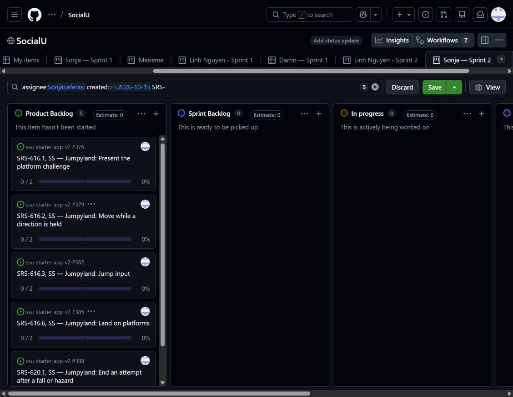

# Sonja Seferasi — Sprint 2 evidence

Prepared 22 October 2026. Owner: Sonja Seferasi (SS). This is an implementation and acceptance audit; it does not claim Canvas submission, demo attendance, hosted deployment or fully accepted requirements. Linh's existing documentation/sprint2 files and all Sprint 1 records are preserved.

## Code and merge links

- [Sprint 2 evidence PR #525](https://github.com/SonjaSeferasi/ssu-starter-app-v2/pull/525), branch sonja/sprint-2-evidence.
- [Avatar feature branch](https://github.com/SonjaSeferasi/ssu-starter-app-v2/tree/feature/avatar-layered-collection).
- [Merged avatar PR #515](https://github.com/SonjaSeferasi/ssu-starter-app-v2/pull/515), merge commit [eab5235](https://github.com/SonjaSeferasi/ssu-starter-app-v2/commit/eab5235b867e608693240ede1184c7ba23d1c843). This includes 24 source sheets, 144 runtime pieces, opt-in selection, calibrated glasses/head placement, importer/manifest validation and save guards.
- [Original Jumpyland implementation PR #451](https://github.com/SonjaSeferasi/ssu-starter-app-v2/pull/451), verified merged. Its original branch used Phaser.
- [Later Jumpyland integration 04af351](https://github.com/SonjaSeferasi/ssu-starter-app-v2/commit/04af351). The current map/engine uses Three.js and Blender-authored model assets, superseding the original renderer plan. This later integration was a direct merge commit, not a newly invented PR.
- [Reviewed integrated source](https://github.com/SonjaSeferasi/ssu-starter-app-v2/tree/eab5235b867e608693240ede1184c7ba23d1c843).

## Prioritized avatar backlog

Priority follows the workflow: entitled catalog choices, outfit preview, provided face preview, persistence restoration, gameplay reuse, then reopening customization. These avatar issues are supporting work. Sonja clarified that Sprint 2 board organization must use the existing Jumpyland SRS cards already in the backlog; these avatar cards are not substituted for them.

| Priority | Exact requirement | Issue | Current outcome |
| --- | --- | --- | --- |
| 1 | SRS-608.1 | [#516](https://github.com/SonjaSeferasi/ssu-starter-app-v2/issues/516) | Merged supporting implementation; live acceptance pending |
| 2 | SRS-608.2 | [#517](https://github.com/SonjaSeferasi/ssu-starter-app-v2/issues/517) | Merged supporting implementation; live acceptance pending |
| 3 | SRS-608.4 | [#518](https://github.com/SonjaSeferasi/ssu-starter-app-v2/issues/518) | Merged supporting implementation; live acceptance pending |
| 4 | SRS-610.1 | [#519](https://github.com/SonjaSeferasi/ssu-starter-app-v2/issues/519) | Merged supporting implementation; live acceptance pending |
| 5 | SRS-610.2 | [#520](https://github.com/SonjaSeferasi/ssu-starter-app-v2/issues/520) | Merged supporting implementation; live acceptance pending |
| 6 | SRS-611.1 | [#521](https://github.com/SonjaSeferasi/ssu-starter-app-v2/issues/521) | Merged supporting implementation; live acceptance pending |

These six issues preserve the exact shall statement, acceptance criterion and UR trace from the canonical SRS. Each includes code locations, explanation, merge link, picture, demo steps and acceptance gaps. They were created after implementation for traceability, not as evidence that implementation began on their creation date.

## Supporting avatar preview tasks: SRS-608.2

When a student selects an available outfit, the system shall display that complete outfit on the Game Room avatar. Acceptance: with the outfit selector open, choosing an outfit displays the selected complete outfit. Traces to UR-608.

[Parent #517](https://github.com/SonjaSeferasi/ssu-starter-app-v2/issues/517) has three actual linked sub-issues, not only checklist text.

| Task | Work | Status |
| --- | --- | --- |
| [#522](https://github.com/SonjaSeferasi/ssu-starter-app-v2/issues/522) | Task 608.2-1 — Implement immediate account-owned outfit preview | Complete for the stated code/test scope |
| [#523](https://github.com/SonjaSeferasi/ssu-starter-app-v2/issues/523) | Task 608.2-2 — Verify imported artwork and preview data contracts | Complete for the stated code/test scope |
| [#524](https://github.com/SonjaSeferasi/ssu-starter-app-v2/issues/524) | Task 608.2-3 — Demonstrate signed-in outfit preview and attach app screenshot | Open: signed-in app screenshot and demo pending |

Preview does not require a database write. The vertical slice consumes the account API's entitled outfits, updates the client's draft and shared avatar renderer, validates layer/manifest inputs, and tests the data/layout contracts. Persistence/ownership tests support safe integration but do not replace the preview's UI acceptance. No artificial SQL task was added just to label this a vertical slice.

## Existing Jumpyland cards reconciled

| Requirement | Existing issue | Evidence and limitation |
| --- | --- | --- |
| SRS-616.1, platform challenge | [#376](https://github.com/SonjaSeferasi/ssu-starter-app-v2/issues/376) | Authored courses and 3D scenery implemented; 2D/3D baseline and exact finish-flag presentation need acceptance review |
| SRS-616.2, held-direction movement | [#379](https://github.com/SonjaSeferasi/ssu-starter-app-v2/issues/379) | Input/velocity implementation and automated checks; signed-in control demonstration pending |
| SRS-616.3, jump input | [#382](https://github.com/SonjaSeferasi/ssu-starter-app-v2/issues/382) | Buffered grounded jump; powered double-jump extension distinguished; browser acceptance pending |
| SRS-616.6, platform landing | [#385](https://github.com/SonjaSeferasi/ssu-starter-app-v2/issues/385) | Terrain/collision geometry checks pass; real gameplay acceptance pending |
| SRS-620.1, fall/hazard failure | [#388](https://github.com/SonjaSeferasi/ssu-starter-app-v2/issues/388) | Requirements gap: current three-heart/checkpoint behavior differs from end-on-every-fall-or-hazard |

The five existing parents, their ten implementation/verification tasks (#377–390), and historical development plan #375 received current explanations, source/merge links and environment review pictures. Existing issues were reused; no duplicate Jumpyland SRS cards were created. All remain open. Historical Phaser planning text is retained and explicitly distinguished from the current Three.js implementation.

## Pictures and their meaning

These are imported-art composition renders using the real layer layout, not screenshots of a browser or proof of hosted account saving. More variants are in output/avatar-art.

These existing Blender asset-review renders show the modeled environments. They do not establish actual browser rendering, gameplay correctness or photorealistic fidelity to Sonja's supplied references.

## Validation

The integrated avatar branch at fc049f0 (same application tree merged in eab5235) passed all 606 tests across 54 files and npm run build, including TypeScript checking and 41 page builds. The new asset checks cover all 144 transparent PNGs, 24 source-sheet imports and 1,224 supported avatar combinations. Three Python importer checks passed during implementation. Disposable PostgreSQL tests execute the real avatar schema/migration and check save/reload, legacy appearance retention, entitlement restrictions and private RPC access. API tests mock Supabase; geometry and composition tests are not live UI tests.

Initial running-game screenshot capture: Not Run because the initial browser connection was unavailable. A later connected browser captured the actual GitHub board screenshot below. Hosted saving and full playthroughs remain unverified; Canvas submission and demo attendance are not claimed.

## Requirements decisions still needed

1. The current editor uses explicit Save avatar and retains the failed draft. Sonja requested that later behavior, but SRS-608.3/608.5 specify automatic saving and SRS-608.6 specifies restoring the previous appearance on failure. Do not mark these exact requirements accepted until the team reconciles the baseline.
2. Current Jumpyland uses a Three.js 3D scene with side-view movement instead of the original Phaser/2D plan. Preserve this requested implementation while recording the baseline decision.
3. Current gameplay loses hearts and respawns at checkpoints; SRS-620.1 requires each fall/hazard to end an attempt. This is an explicit acceptance gap, not a completed requirement.
4. Hosted use of new layered options requires supabase/migrations/20261018020000_avatar_layers.sql if not already applied. No hosted migration was executed by this audit.

## Board organization and current limitation

The existing five Jumpyland SRS parents (#376, #379, #382, #385 and #388) are the board scope Sonja identified. Their ten original tasks and development-plan issue #375 are retained. No duplicate Jumpyland cards were created. The six avatar issues above remain supporting work; no final formal demo selection is assumed.

A separate [Sonja — Sprint 2 view](https://github.com/users/SonjaSeferasi/projects/2/views/15) was created through the signed-in browser, with Sonja's issues created from 15 October onward. Its saved name was observed after reloading. The current URL filter further shows just the five SRS parent cards; their actual tasks remain linked underneath. GitHub did not confirm persistence of that narrower filter (the Save control remained visible).

This is a real screenshot of the GitHub board, not a design mockup or gameplay image. It records the five existing SRS cards. GitHub intermittently displayed "This project failed to load" and reverted attempted moves to In review. Status changes were not confirmed; no card is claimed Done from this audit. The Git credential's missing Projects scopes also prevents an API fallback. Fresh browser access was subsequently established through the in-app browser; the earlier browser-unavailable note describes the initial validation attempt only.

Before submission: resolve the project save/connection issue, finish exact signed-in acceptance checks and attach running-app screenshots to the existing SRS cards, then update statuses in accordance with the team's Definition of Done. Reconcile the 2D/3D and finite-life requirements gaps before accepting those requirements. Canvas submission and actual demo attendance remain student actions. No teammate view or Sprint 1 card was changed.
