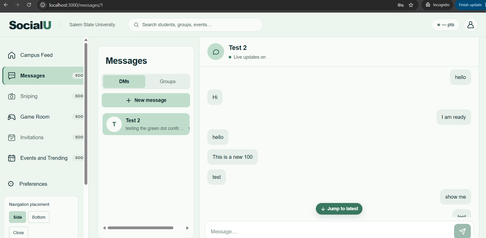
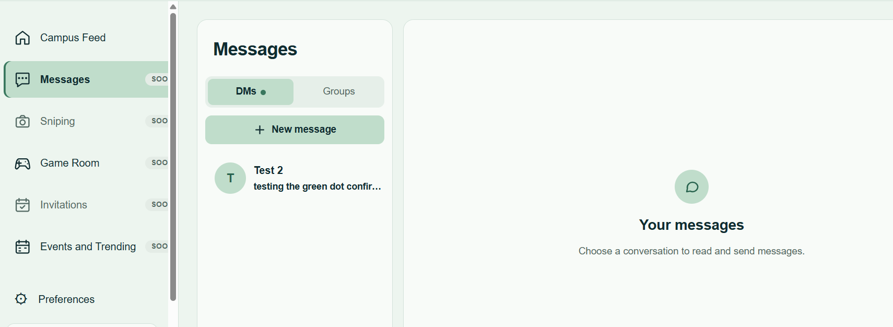
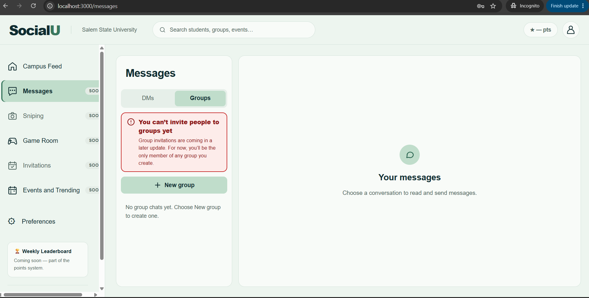
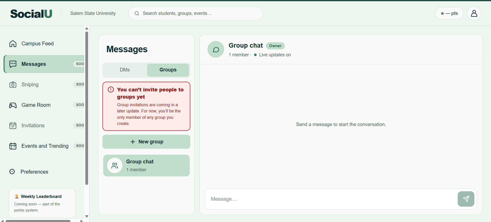
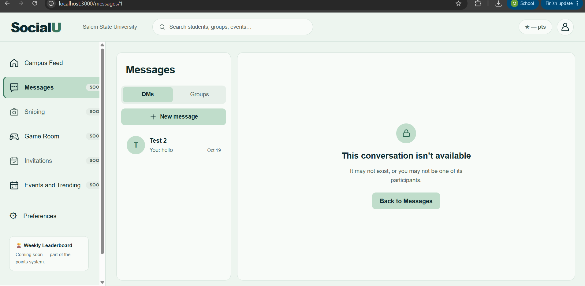

# Sprint 2 evidence — Chat, LP

Screenshots of the running application (`npm run dev`, integrated `main`) captured by Loens Paul on October 21, 2026. They show the Sprint 2 Chat behavior working end to end with the team's test accounts. No email addresses, passwords or other private student information appear in them.

Each screenshot is also posted on its SRS issue, together with the branch and pull request links.

| SRS item | Issue | Screenshot | Branch | Pull request |
|---|---|---|---|---|
| SRS-200.1, LP, Start a friend conversation | #311 | *to be added* | `srs-200.1-start-friend-conversation` | #471 |
| SRS-201.2, LP, Display a sent text message | #316 | `srs-201.2-srs-212.5-conversation-opened.png` | `srs-201.2-message-history` | #462 |
| SRS-202.1, LP, Create a group chat | #452 | `srs-202.1-groups-tab-before.png`, `srs-202.1-srs-203.1-group-created-owner.png` | `srs-202.1-create-group` (follow-ups: `srs-202.1-sticky-conversation-list`, `srs-202.1-group-step-and-back-button`, `srs-202.1-group-invites-notice`) | #463 (follow-ups #470, #472, #473) |
| SRS-203.1, LP, Assign initial ownership | #453 | `srs-202.1-srs-203.1-group-created-owner.png` | `srs-202.1-create-group` | #463 |
| SRS-212.4, LP, Display an unread-conversation indicator | #326 | `srs-212.4-unread-conversation.png` | `srs-212.4-unread-indicator` | #469 |
| SRS-212.5, LP, Mark existing messages as read when opening a conversation | #465 | `srs-201.2-srs-212.5-conversation-opened.png` | `srs-212.4-unread-indicator` | #469 |
| SRS-213.1, LP, Restrict private-conversation access | #321 | `srs-213.1-not-available.png` | `srs-213.1-private-access` | #464 |

## What each screenshot shows

**SRS-201.2 and SRS-212.5** — `srs-201.2-srs-212.5-conversation-opened.png`

The conversation at `/messages/1` shows the saved text messages, oldest first, with **Live updates on**. Because the conversation is open, its messages are marked read: the conversation is no longer bold and the DMs tab no longer has a dot (compare with the SRS-212.4 screenshot).

**SRS-212.4** — `srs-212.4-unread-conversation.png`

A new message from Test 2 has not been read yet: the conversation is shown in bold and the DMs tab shows a dot. (With a long preview like this one, the conversation's own dot sits past the right edge of the list; with a short preview it shows beside the time.)

**SRS-202.1** — `srs-202.1-groups-tab-before.png`

Before: the Groups tab has no group chats, a **New group** button, and a notice that group invitations (SRS-205) are not available yet.

**SRS-202.1 and SRS-203.1** — `srs-202.1-srs-203.1-group-created-owner.png`

After choosing **New group** and confirming, the new group appears in the Groups list and opens. The header shows the creator's **Owner** role and **1 member** (the creator).

**SRS-213.1** — `srs-213.1-not-available.png`

Signed in as a student who is not one of the two participants in conversation 1, opening `/messages/1` shows **This conversation isn't available**. The server returns 404 for the history and for sending, and live messages only go to each participant's private channel.

## Validation

- 383 automated tests passed on `main` at the end of Sprint 2, including the in-memory database checks in `__tests__/database/chat.test.ts`.
- All seven Chat migrations were applied to the hosted database after a rolled-back dry run, and recorded in its migration history.
