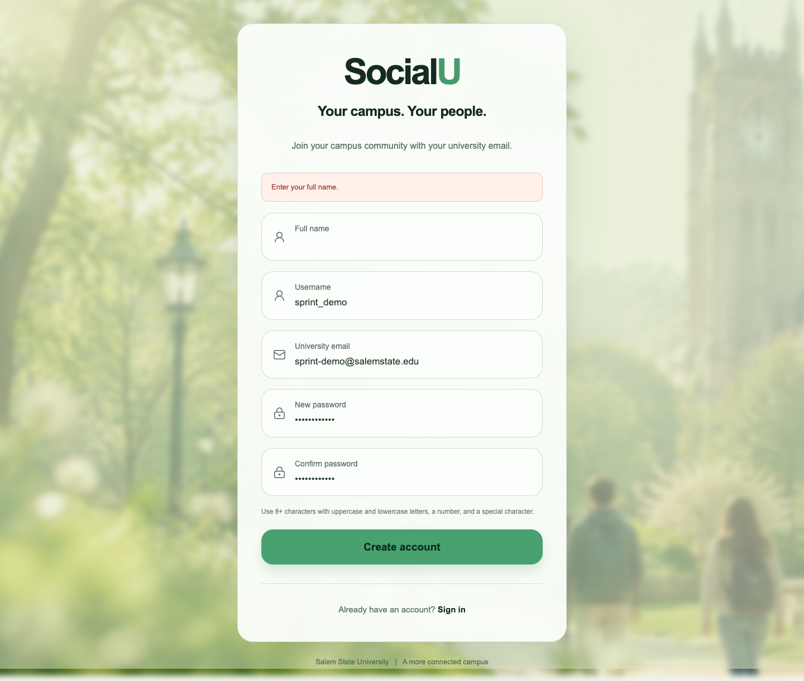

# Sprint 1 evidence — SRS-100.1, LN

Selected requirement: **SRS-100.1, LN — Full name registration.**

The system shall require a student to enter a full name when creating a SocialU account.

Traces to: UR-100

## Running application evidence

Captured October 13, 2026 from the running SRS-100.1 branch on `/register`. The form contained synthetic test values and a whitespace-only full name. Submitting showed **Enter your full name.** and produced **zero registration API requests**. This demonstrates the specified prevention behavior; it does not claim an account was created, an email was delivered, or a successful full-name write was tested live.

A direct request to the running registration API with a whitespace-only full name also returned HTTP 400 with the same message. The existing data contract passes valid trimmed full names through `socialu_account` and Supabase signup metadata; API regression tests cover that handoff with mocked Supabase.

## Validation

- 169 tests passed across 12 files, including 32 authentication API cases.
- TypeScript check passed.
- Production build passed.

## Canvas checklist

- Team GitHub Project link.
- Board screenshot showing five selected LN SRS cards and SRS-100.1 with its task sub-issues.
- SRS-100.1 issue #45 with branch/PR links and this screenshot.
- Merged focused SRS-100.1 pull request link.
- Attend the sprint demo and demonstrate from the integrated checked-in code.

The board screenshot and the course requirement for status changes throughout the week cannot be substituted by this application screenshot. The issue history records a format correction on October 13; no earlier history was fabricated. Linh Nguyen confirmed the team’s agreement to the repository Definition of Done on October 15, 2026.
