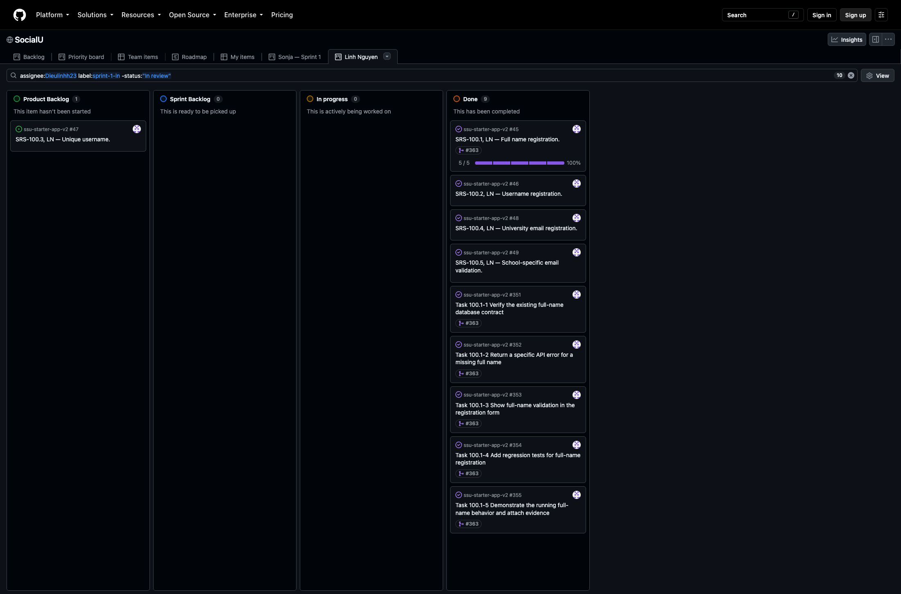

# CSC 351 — Sprint 1 submission — Linh Nguyen (LN)

Selected SRS item: **SRS-100.1, LN — Full name registration.**

The system shall require a student to enter a full name when creating a SocialU account.

Traces to: UR-100

## Board view correction — October 28, 2026

The saved Sprint 1 view now uses `assignee:Dieulinhh23 label:sprint-1-ln`, limiting it to the five SRS cards and five selected task issues (10 items). Broader UR summaries and later work remain in the project but no longer appear in this view. No issue completion dates, graded history or application code were changed. The original October 15 screenshot below is retained as historical evidence; the current view is captured in [sprint1-board-corrected-20261028.png](sprint1-board-corrected-20261028.png).

## Submit in Canvas

1. [Team GitHub Project / LN view](https://github.com/users/SonjaSeferasi/projects/2/views/8).
2. Upload [the board screenshot](sprint1-board.png). It shows five LN SRS cards and the selected item with its five linked tasks.
3. [Sprint 1 SRS issue #45](https://github.com/SonjaSeferasi/ssu-starter-app-v2/issues/45): requirement, UR trace, assigned sub-issues, named branch, merged PR and real running-application screenshot.
4. [Merged implementation PR #363](https://github.com/SonjaSeferasi/ssu-starter-app-v2/pull/363).

The five SRS items are #45–#49. Only #45 is the Sprint 1 commitment. #46, #48 and #49 are additional completed work verified on October 15; #47 remains open for registration username uniqueness. Completed work is shown in Done rather than moved backward to make the board resemble a planning example. Sprint Backlog and In progress are empty at this completed-submission snapshot.

## Five-minute demo guide

| Time | What to show |
| --- | --- |
| 0:00–0:45 | Open #45. Read the shall statement, UR-100 trace and the exact missing-name acceptance criterion. |
| 0:45–1:30 | Show its five assigned sub-issues and the named branch. Explain the existing database contract, API, UI, tests and live evidence. |
| 1:30–3:15 | From the team's single integrated checkout, run the app and open `/register`. Show the required Full name field. Submit with it empty. Then use only spaces in Full name and valid synthetic values in the other fields; the real form shows “Enter your full name.” and does not continue. Do not submit a valid account unless you intend to create one and have a suitable test email. |
| 3:15–4:15 | Show the running API's HTTP 400 for a whitespace-only name, and show the API regression tests. Explain that no provider signup or database write occurs for invalid input. |
| 4:15–5:00 | Show merged PR #363 and the screenshot on #45. State the limitations below, including the separate #47 follow-up. |

Run from the integrated code checked into the team repository, not a separate mockup. On a clean checkout, install dependencies and configure local environment variables as described by the project before running `npm run dev`.

## Evidence and its limits

- [Actual running registration screenshot and reproducible notes](README.md).
- The real form rejected a whitespace-only name before signup; zero registration API requests were recorded for that attempt.
- The actual registration API returned HTTP 400 with “Enter your full name.” for a whitespace-only name.
- 169 application tests, TypeScript and production build passed on the focused implementation snapshot. A later October 15 audit of main at ac6ae69 passed all 32 authentication API tests and nine actual invalid-input API cases.
- Supabase SDK calls are mocked in API tests. The tests verify the accepted full name is passed to the database precheck and signup metadata, but a successful live signup/full-name persistence demonstration was not performed.
- The existing data contract came from earlier account integration; PR #363 is the focused SRS-100.1 validation/evidence change. This does not claim that all reused account code was first written on the Sprint 1 branch.

## Rubric self-check

| Criterion | Points | Evidence / remaining limitation |
| --- | ---: | --- |
| Product Backlog | 4 | Five exact LN SRS titles with shall statements and UR traces; numeric priority recorded below. |
| Sprint 1 item and tasks | 6 | One selected item (#45), five assigned task sub-issues, completed-state progress 5/5. Existing schema covers the data layer; successful storage write is not claimed as live-tested. |
| Branch and code links | 5 | SRS-named branch and merged PR #363, with Closes references for #45 and #351–#355. |
| Evidence it works | 3 | Actual missing-name rejection screenshot on #45. |
| Board kept current | 3 | Status corrections were made October 13 and the additional-work audit October 15. These do not establish steady status updates throughout the sprint; this history cannot be recreated retroactively. |
| Sprint demo | 9 | Not yet assessed. Linh must attend and demonstrate the checked-in integrated product. The professor decides whether the demonstration satisfies the criterion. |

Backlog priority: 100.1 full name → 100.2 username entry → 100.3 unique username → 100.4 university email entry → 100.5 approved school domain. The selected validation slice depends on the existing account/schema infrastructure; no unrelated features were added to the Sprint 1 commitment.

The [Definition of Done](../definition-of-done.md) records Linh’s October 15 confirmation of team agreement. This self-check is not a promised grade or a claim that the assignment’s board-history/demo requirements are already satisfied.
