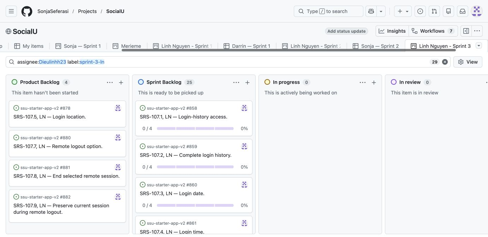

# Sprint 3 planning — Linh Nguyen (LN)

> **Implementation update — October 29, 2026:** the five selected items now have code on their SRS branches and draft PRs [#963](https://github.com/SonjaSeferasi/ssu-starter-app-v2/pull/963), [#964](https://github.com/SonjaSeferasi/ssu-starter-app-v2/pull/964), [#965](https://github.com/SonjaSeferasi/ssu-starter-app-v2/pull/965), [#966](https://github.com/SonjaSeferasi/ssu-starter-app-v2/pull/966) and [#967](https://github.com/SonjaSeferasi/ssu-starter-app-v2/pull/967). All 1,028 tests and the production build pass. The approved database setup is installed and real signed-in screenshots are linked on each SRS card. Review and merge remain pending; the five parents and 20 tasks are In progress and open. See the [implementation and evidence record](https://github.com/SonjaSeferasi/ssu-starter-app-v2/blob/linh/srs-107.6-active-session-status/documentation/sprint3/implementation/README.md). The dated planning tables below preserve the pre-implementation plan and are not the current board status.

Prepared October 27; scope reviewed October 28, 2026 from the professor's CSC 351 Sprint 3 assignment. **Planning only: no new Sprint 3 implementation or completion is claimed.**

## Review this first

- Team Project: https://github.com/users/SonjaSeferasi/projects/2
- Personal Sprint 3 board: https://github.com/users/SonjaSeferasi/projects/2/views/16
- Owner and required assignee for every SRS card and task: `Dieulinhh23`.
- Canonical requirements: [SocialU SRS](../SocialU_SRS_Editable.md).
- Remaining work and Sprint 4 risks: [October 28 audit](remaining-work-audit.md).
- Completion rules: [team Definition of Done](../definition-of-done.md).
- Copyable card, task and PR bodies: [templates](templates.md).
- Original prepared SRS/task templates: [ready-issues.md](ready-issues.md); structured plan with actual issue IDs: [issue-plan.json](issue-plan.json). Verified published links are recorded in [publication.json](publication.json).

This branch is for planning files only. It is not an implementation branch for any SRS item. Create each item's own SRS-named branch before coding and put that item's actual implementation commits and PR on that branch.

## Current setup status

| Part | Status |
| --- | --- |
| Sprint 3 instructions reviewed | Complete |
| Scope and exact SRS selection | Login Activity: SRS-107.1–107.4 and SRS-107.6, selected from Linh's supplied ownership area after the initial code/backlog audit |
| Planning templates | Prepared |
| GitHub SRS cards and task sub-issues | Published through the reconnected GitHub browser: nine SRS parents and 20 real linked task sub-issues, all open and assigned to Dieulinhh23 |
| Sprint 3 board view and statuses | Saved “Linh Nguyen - Sprint 3” view; filter `assignee:Dieulinhh23 label:sprint-3-ln`; four future requirements in Product Backlog, five selected parents and 20 tasks in Sprint Backlog |
| Per-SRS implementation branches | Five SRS-named branches created before coding: the original four at `2b3a521`, and SRS-107.6 at current main `7d048ef`; no implementation commits yet |
| New Sprint 3 implementation | Not started in this setup |
| Tests, merged implementation PRs and screenshots | Add after implementation; no results claimed yet |

## Selected work and later scope

Sprint 3 prepares the read-only Login Activity feature: access to the student's own recorded history, access to all recorded entries, recorded date/time display, and actual active-session status. Five selected items have 20 linked task sub-issues in total. These are unstarted implementation plans, not a claim that branches alone satisfy the assignment.

The historical #125–#133 issues were checked: they are closed as `not_planned`, not completed implementation. This setup leaves those retirement records unchanged. The connector initially returned 403, but browser access later recovered and the new exact SRS parents and linked tasks were published through GitHub's normal UI.

Reserve SRS-107.5 and SRS-107.7–107.9 for later selection: recorded location when available, the remote logout action, actual remote termination, and preservation of the current session. University-email changes (UR-106), logout confirmation (UR-108), smaller SRS corrections and acceptance checks also remain. The [remaining-work audit](remaining-work-audit.md) records all LN areas and the delivery risk.

Resolve the email-link versus six-digit-code requirements and required-profile-field findings with the instructor/team early. Existing code does not prove those criteria are satisfied, and completion of all remaining requirements in one final sprint is not yet established. This plan changes no canonical SRS wording.

Existing graded Sprint 1 and Sprint 2 records, the profile evidence branch, prior merged PRs and the local-only unfriend edits remain separate. No new SRS numbers or changed shall statements are introduced by this planning setup.

## Product Backlog and Sprint Backlog

The board is set up in the dependency order below. All cards and tasks are open. Do not move them to In progress until work actually starts. Each selected parent shows **0/4** tasks complete. No earlier sprint view or teammate card was edited.

| Priority | Exact SRS title and issue link | Status | Branch link | Task sub-issues |
| --- | --- | --- | --- | --- |
| 1 | [SRS-107.1, LN — Login-history access. #858](https://github.com/SonjaSeferasi/ssu-starter-app-v2/issues/858) | Sprint Backlog | [`linh/srs-107.1-login-history-access`](https://github.com/SonjaSeferasi/ssu-starter-app-v2/tree/linh/srs-107.1-login-history-access) | #862–#865; 0/4 complete |
| 2 | [SRS-107.2, LN — Complete login history. #859](https://github.com/SonjaSeferasi/ssu-starter-app-v2/issues/859) | Sprint Backlog | [`linh/srs-107.2-complete-login-history`](https://github.com/SonjaSeferasi/ssu-starter-app-v2/tree/linh/srs-107.2-complete-login-history) | #866–#869; 0/4 complete |
| 3 | [SRS-107.3, LN — Login date. #860](https://github.com/SonjaSeferasi/ssu-starter-app-v2/issues/860) | Sprint Backlog | [`linh/srs-107.3-login-date`](https://github.com/SonjaSeferasi/ssu-starter-app-v2/tree/linh/srs-107.3-login-date) | #870–#873; 0/4 complete |
| 4 | [SRS-107.4, LN — Login time. #861](https://github.com/SonjaSeferasi/ssu-starter-app-v2/issues/861) | Sprint Backlog | [`linh/srs-107.4-login-time`](https://github.com/SonjaSeferasi/ssu-starter-app-v2/tree/linh/srs-107.4-login-time) | #874–#877; 0/4 complete |
| 5 | [SRS-107.6, LN — Active-session status. #879](https://github.com/SonjaSeferasi/ssu-starter-app-v2/issues/879) | Sprint Backlog | [`linh/srs-107.6-active-session-status`](https://github.com/SonjaSeferasi/ssu-starter-app-v2/tree/linh/srs-107.6-active-session-status) | #915–#918; 0/4 complete |
| Later | SRS-107.5, 107.7–107.9: [#878](https://github.com/SonjaSeferasi/ssu-starter-app-v2/issues/878), [#880](https://github.com/SonjaSeferasi/ssu-starter-app-v2/issues/880), [#881](https://github.com/SonjaSeferasi/ssu-starter-app-v2/issues/881), [#882](https://github.com/SonjaSeferasi/ssu-starter-app-v2/issues/882) | Product Backlog; not selected for Sprint 3 | Create when selected | Decompose when selected |

This screenshot is planning/board evidence only. It does not replace the per-SRS screenshots of the running application required after implementation.

`database/schema.sql` already proposes a `login_sessions` table with a recorded timestamp, optional location, remembered-session flag and revocation timestamp. The first item's data task must verify how that reviewed schema relates to the live auth/session implementation. Do not add redundant tables or treat provider active sessions as complete historical records without checking retention.

The professor requires several SRS items; one broad UR or this planning document does not replace those cards.

## Set up each selected SRS item

1. Use its exact title from the canonical SRS, including number, LN initials and wording. Paste its exact shall statement, acceptance criterion and `Traces to: UR-…` line. Link its existing UR overview and the corresponding [URD story](../user_requirements.md).
2. Assign the SRS parent to `Dieulinhh23`; add it to the team Project with the appropriate backlog status.
3. Create actual task sub-issues covering the data contract/database, API, UI and automated plus live acceptance needed for that behavior. Assign every task to `Dieulinhh23`. A checklist or a `Parent: #…` sentence alone does not establish a GitHub sub-issue relationship.
4. Create the SRS-named branch from an up-to-date integrated baseline before coding, for example `linh/srs-107.1-login-history-access`. All five selected branches already exist and are linked from their SRS issues. When coding starts, switch to the correct branch and integrate needed reviewed dependencies first; keep the actual implementation on that SRS branch.
5. Keep tasks open and the parent in Sprint Backlog until work starts. Update statuses during the week as work changes.

Existing schema can satisfy the data layer. Add only tasks needed by the exact SRS behavior; do not add unrelated features to inflate the slice.

## Add implementation and evidence later

For each selected SRS item:

- Do its actual coding on its own SRS-named branch. A later empty branch is not a substitute.
- Open a PR to `main` with the problem, resulting behavior and validation. Use `Closes #<task issue>` for each task the PR actually completes. Link the PR from the SRS card. Close the parent only when its complete acceptance and Definition of Done are satisfied.
- Attach a screenshot directly to the SRS issue showing that exact behavior in the running integrated app. Include route, date, commit, reproduction steps and result. Test logs and design mockups do not replace the screenshot.
- Keep recorded automated results separate from live hosted acceptance. Do not claim a passing save, persistence check, or database deployment before verifying it.
- If SRS/schema changes become necessary, record the finding on the relevant card and review the actual change. This setup does not authorize rewriting the canonical requirements.

## Demo and submission — at sprint end

Linh must attend demo day. Show the integrated checked-in application on one laptop, the SRS parents and linked tasks, each behavior end to end, and each merged PR. Allow about five minutes. Describe unfinished work honestly and return it to Product Backlog for Sprint 4.

Canvas links to fill in later:

- Team Project link: https://github.com/users/SonjaSeferasi/projects/2
- Sprint 3 SRS issue links: #858, #859, #860, #861 and #879 above; application evidence and implementation PRs must be added later.
- Each merged implementation PR: pending implementation.

The assignment totals 50 points: Product Backlog 6; sprint items/tasks 10; branches/code links 9; screenshots 5; current board 5; demo 15. This plan does not guarantee points or claim submission/attendance.
