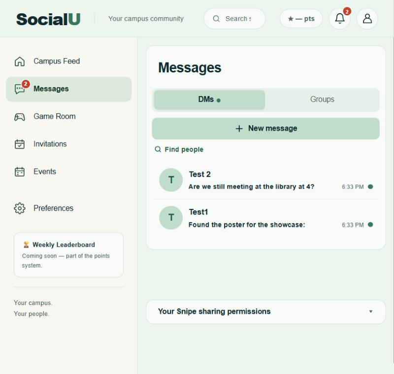
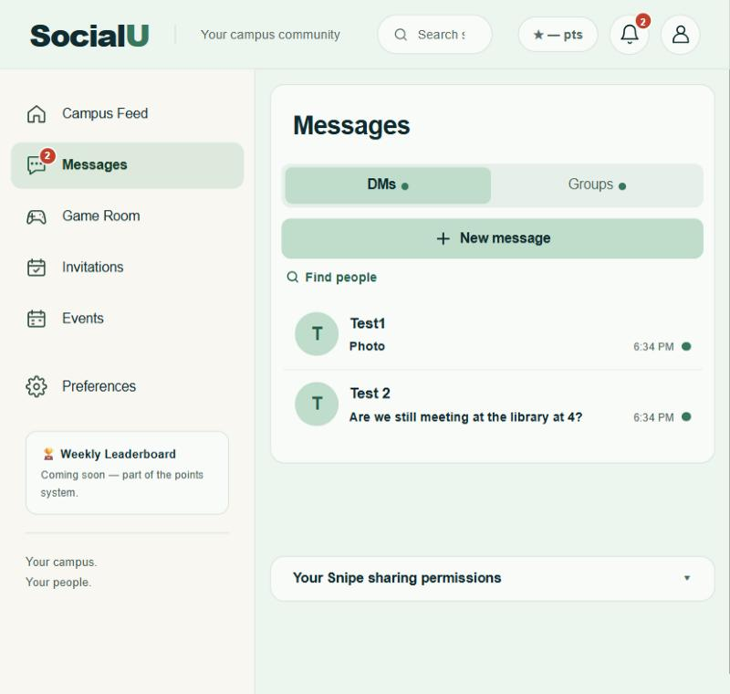
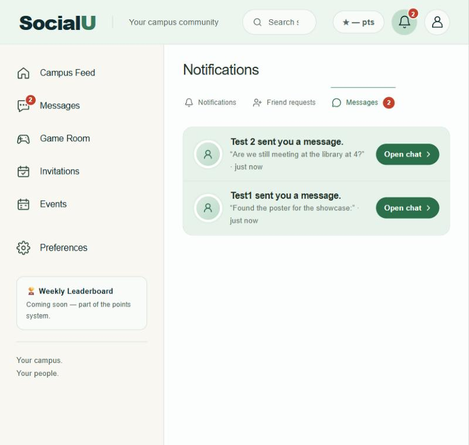
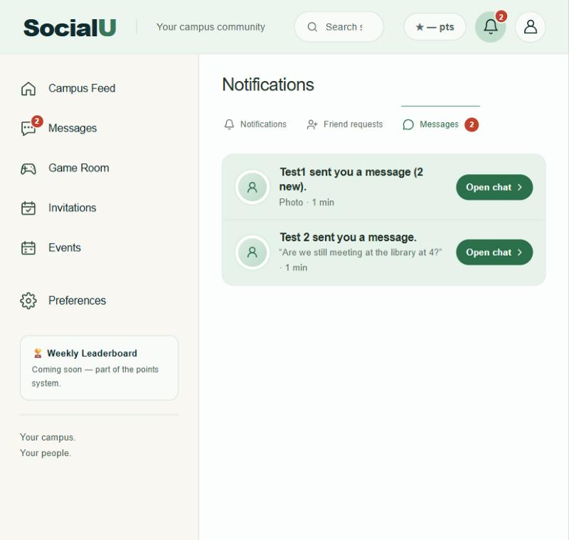

# Bug #1217 — a photo counts as a message in the Messages list and in notifications

Owner: Loens Paul / bosspml. Severity: Major.
Requirement: SRS-205.6, SRS-206.2, SRS-211.3. Reported by MeriemeSakhs in the Sprint 4 messaging audit (#1236).
Branch: `lp/bug-1217-photo-in-list-and-notifications`, merged in [#1240](https://github.com/SonjaSeferasi/ssu-starter-app-v2/pull/1240).
Migration: `20261112120000_chat_photo_in_list_and_notifications.sql`.

## Explanation for class

“Two database functions decided what counts as a message by looking at its kind, and both of them
listed only `text` and `emoji`. A photo is a third kind, so to those two functions a photo was not a
message at all. If the only thing in a conversation was a photo, my Messages list said `No messages
yet`; if a photo was the newest thing, the conversation did not move to the top; and no notification
was raised for it. The message was there the whole time — you had to already be inside the
conversation to see it.”

The fix widens both filters to include `photo`, and sends the message's kind up with the preview so
the page can say `Photo` where a photo has no text to quote.

## Why the preview needed its own module

A photo row has `text = NULL`, by a rule in the schema: a photo carries no words. The notification
component formatted previews with `item.text.length`, which throws on `null`. So the moment the
database started returning photos, the old page would have crashed on them — the fix had to land as
one change, not as a database change followed by a page change.

`lib/chat-preview.ts` holds the three rules (`previewBody`, `conversationPreview`,
`notificationPreview`) as plain functions, because vitest runs here with `environment: 'node'` and
there is no React testing library: a rule written inside the component cannot be covered by a test.
`__tests__/chat-preview.test.ts` covers them directly.

## Verified evidence

Taken on November 16, 2026 against `scripts/tests/chat-evidence-fixture.mjs`, which runs the real
Next UI and the real API routes over the real migrations in a disposable in-memory PGlite database.
Only Supabase's Auth and PostgREST transport is replaced. **The hosted database is never contacted** —
every network request the page made went to `127.0.0.1`, and the browser bundle contains no hosted
project URL.

The same fixture runs in two modes against **identical seed data**. `--before` omits both chat fixes,
`20261112120000` and `20261116130000`, so the older function bodies stay in place; everything else,
the page code included, is the same build.

Three students are seeded, under the names of the accounts this project is tested with: **Loens**,
**Test1** and **Test 2**. They are local rows in the fixture's own database, not the hosted accounts.

Seeded, in this order: Test1 sends a line of text, then Test 2 sends a line of text, then Test1 sends
a photo. So the photo is the newest thing in either conversation, and Test1's text is the oldest —
which is what makes both halves of the defect visible in one screenshot.

### 1. The Messages list

| before | after |
| --- | --- |
|  |  |

**Before**, the photo may as well not exist:

- Test 2 sits on top, although Test1's photo is newer than their message. A photo was not activity.
- Test1's preview is `Found the poster for the showcase:` — the text sent *before* the photo. The
  list is showing a stale message as though it were the latest.

**After**, Test1's conversation has moved to the top and reads **`Photo`**.

In both shots the Messages badge counts **2** unread. The unread flag never had the kind filter, so
that half was always right — which is exactly what made the old behaviour so confusing: the badge
said there was something new to read and the list showed you something old.

(Where a conversation's *only* message is a photo, the before state reads `No messages yet`; that is
the case Merieme reported, and it is covered by `chat-photo-bugs.test.ts`.)

One difference in this pair is **not** this fix: the Groups tab has an unread dot in the after shot
and none in the before shot. That is #1222's migration, which `--before` also omits — the group Loens
was removed from comes back into the list, and brings its unread mark with it.

### 2. Notifications → Messages

| before | after |
| --- | --- |
|  |  |

**Before**, there are two notifications and neither is the photo. Test1's reads
`Test1 sent you a message.` and quotes the older text.

**After**, it reads `Test1 sent you a message (2 new).` with the body **`Photo`**.

Compare the two lines in the after shot: a text message is shown in quotation marks
(`"Are we still meeting at the library at 4?"`) and the photo is not. That is `notificationPreview` —
quoting the word `Photo` would read as though someone had typed it.

## Tests

`__tests__/chat-preview.test.ts` — 10 tests over the three preview rules, including a `null` text with
kind `photo`, which is the input that used to throw.

`__tests__/database/chat-photo-bugs.test.ts` — Merieme's three reported cases for this bug (preview,
ordering, notification) run against the migration itself in PGlite.

## Hosted migration

`20261112120000` was applied to the hosted project and recorded in
`supabase_migrations.schema_migrations`: read-only probe first, SHA-256 of the editor content checked
against the committed file, a dry run inside a transaction that was rolled back, the rollback verified
to have left nothing behind, then applied and verified.

Both replaced functions repeat the `socialu.community_unavailable` block that Linh's school-community
work installs, because `CREATE OR REPLACE` discards it otherwise.

## Reproducing the evidence

```
node scripts/tests/chat-evidence-fixture.mjs            # the state on main
node scripts/tests/chat-evidence-fixture.mjs --before    # the two fixes omitted
```

Either prints an app URL on `127.0.0.1:3123` and a sign-in token per seeded student. Put one in the
browser with `localStorage.setItem('access_token', '<token>')`, then open `/messages`. Ctrl-C stops it
and the database goes with it — nothing is written anywhere. The same fixture serves #1222's evidence.

It borrows its shape from Linh's `scripts/tests/profile-board-atomic.browser.ts` (#1223), with the
browser driving left out so the screens can be walked through by hand.

## Note on sequencing

The migration was applied several days before [#1240](https://github.com/SonjaSeferasi/ssu-starter-app-v2/pull/1240)
was merged. In that window the hosted database returned photo notifications with `text: null` while
`main` still formatted them with `item.text.length`, so the notification panel could throw for anyone
on `main`. The correct order is the other way round: merge the page that tolerates the new data, then
apply the migration that produces it.
