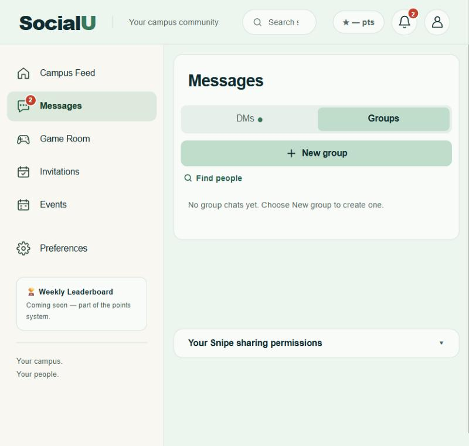
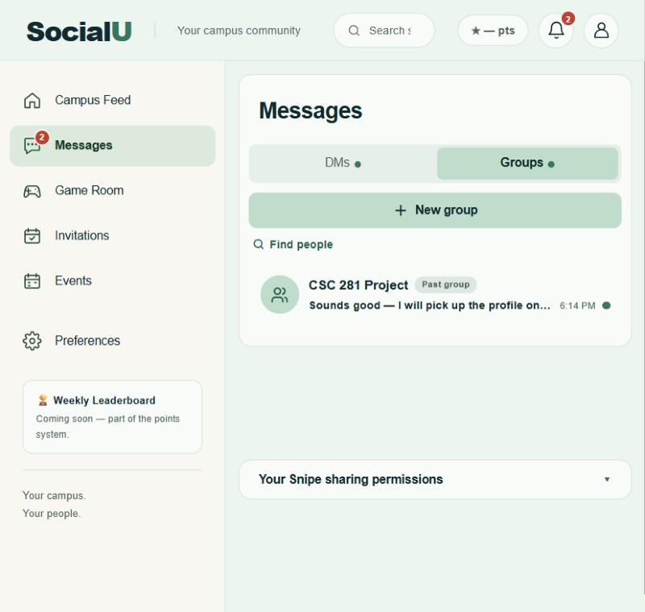
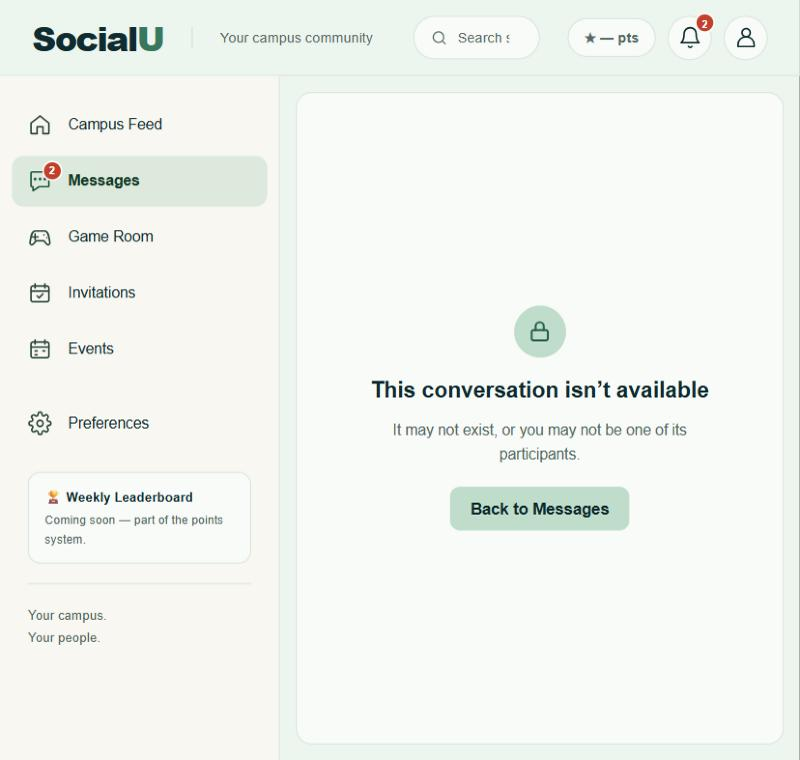
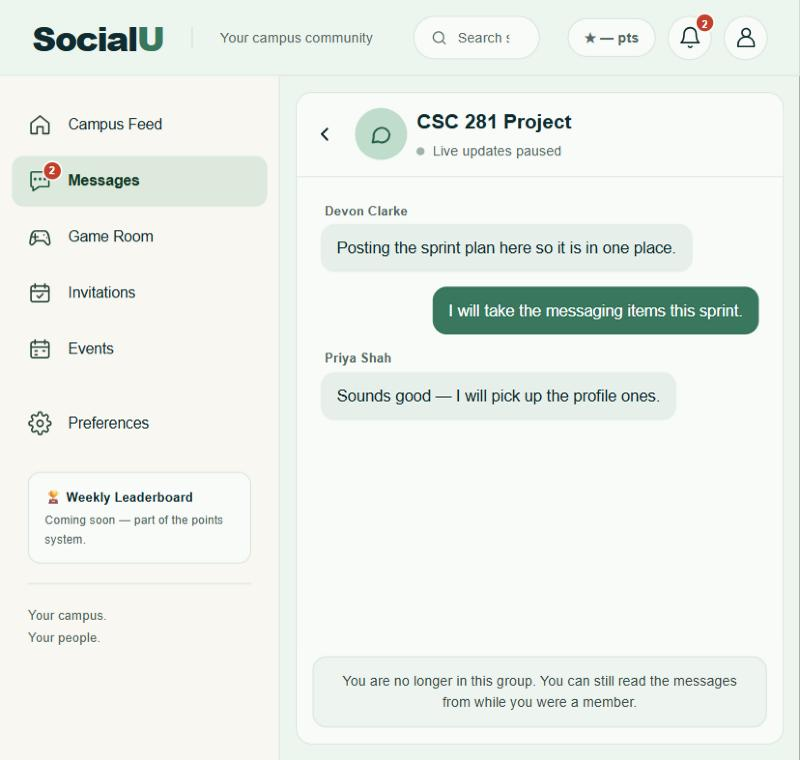
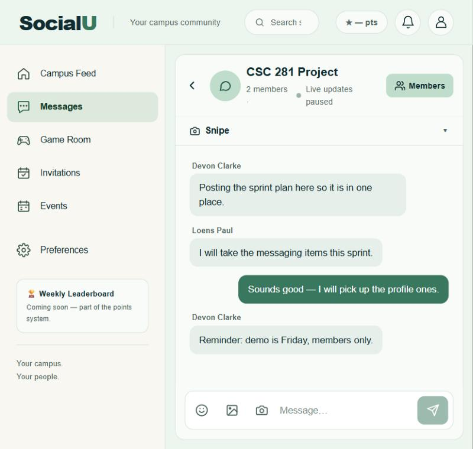

# Bug #1222 — a former group member keeps their own history, read-only

Owner: Loens Paul / bosspml. Severity: Major.
Requirement: SRS-205.13, SRS-207.5, SRS-208.7, SRS-213.5. Reported by MeriemeSakhs in the Sprint 5
messaging audit.
Branch: `lp/bug-1222-former-member-history`, merged in [#1256](https://github.com/SonjaSeferasi/ssu-starter-app-v2/pull/1256).
Migration: `20261116130000_chat_former_member_history.sql`.

## Explanation for class

“When you stopped being in a group — you left, or an owner removed you, or you handed ownership over
and left — the whole conversation disappeared. Not just the ability to post in it: the messages you
had written and read while you were a member went too. The rule that decides whether a single message
is readable already got this right; it matches your membership row and allows messages sent between
the day you joined and the day you left. The screens never reached that rule, because three functions
in front of it asked a different question first — *are you in this group right now* — and turned you
away.”

The fix changes those three gates from “is a current participant” to “was ever a participant”, and
marks what comes back so the page can open it for reading only.

## The choice made here (option b)

Two options were on the table:

- **(a)** keep the conversation out of the Messages list, and only allow it to be opened by direct link.
- **(b)** list it, marked, and open it read-only. ← chosen

(b) was chosen because a conversation you cannot find is not really restored, and because #888
(“delete a former group conversation from the student's view”) needs the conversation to be in the
list before there is anything to delete. (a) would have left #888 with nothing to act on.

## What the fix must not do

Restoring the history must not hand a departed student anything **current** about the group. The
migration is careful about three things that the report did not mention:

- `member_count` is withheld. Membership moved on after they left; the live number is not theirs.
- `senders` is limited to the people who sent the messages they can actually read.
- `role` comes back null — they no longer hold one.

And every write still refuses them. `socialu_send_message`, `socialu_send_emoji`,
`socialu_react_to_message`, `socialu_rename_group`, `socialu_send_group_invitation` and
`socialu_leave_group` were all left strict on purpose, and the test asserts all six still answer
`SC404`. Read access widened; write access did not move.

`socialu_mark_conversation_read` needed the same widening as the two read functions — it was not in
the report, but without it a departed member could open their history and never clear its unread mark.

## The wording

A membership can end three ways, so the notice says what is true now rather than how it came about:

> You are no longer in this group. You can still read the messages from while you were a member.

“You left this group” would be a lie to someone who was removed. The list badge, `Past group`, is
neutral for the same reason. Both strings live in `lib/chat-former-member.ts` with `isReadOnly`,
because vitest runs here with `environment: 'node'` and no React testing library, so a rule written
inside the component could not be covered; `__tests__/chat-former-member.test.ts` asserts, among other
things, that the notice never says “left” or “removed”.

## Verified evidence

Taken on November 16, 2026 against `scripts/tests/chat-evidence-fixture.mjs`, which runs the real Next
UI and the real API routes over the real migrations in a disposable in-memory PGlite database. Only
Supabase's Auth and PostgREST transport is replaced. **The hosted database is never contacted** —
every network request the page made went to `127.0.0.1`, and the browser bundle contains no hosted
project URL.

The same fixture runs in two modes against **identical seed data**. `--before` omits
`20261116130000`, so the older function bodies stay in place; everything else, the page code included,
is the same build. The difference between each pair is the migration and nothing else.

Seeded: Devon Clarke owns **CSC 281 Project** with Loens Paul and Priya Shah. Three messages are sent.
Devon then **removes** Loens — removed rather than left, because the wording has to hold for someone
who did not choose to go — and sends one more message afterwards.

### 1. The group in the Messages list

| before | after |
| --- | --- |
|  |  |

**Before**: `No group chats yet. Choose New group to create one.` The conversation is simply gone, and
nothing on the screen suggests it ever existed.

**After**: it is back, with the **`Past group`** badge. Its preview is
`Sounds good — I will pick up the profile ones.` — Priya's message, the last one sent while Loens was
still a member. The message Devon sent *after* the removal is **not** the preview, which is the point:
the list must not leak what has been said since.

### 2. Opening the conversation

| before | after |
| --- | --- |
|  |  |

**Before**, even following a direct link: `This conversation isn't available. It may not exist, or you
may not be one of its participants.` That is the defect Merieme reported — the student's own words are
behind a door marked *may not exist*.

**After**:

- The three messages from the membership period are all there.
- `Reminder: demo is Friday, members only.` — sent after the removal — **is still not shown**.
- The composer is replaced by the notice. There is no member count, no Members button, no invite
  control and no reaction control.

### 3. A current member is unaffected



Priya Shah, still a member, opens the same conversation on the fixed build: `2 members`, the Members
button, the message sent after the removal, and a working composer. Nothing about the change reaches
people who are still in the group.

### A note on “Live updates paused”

That label appears in every conversation screenshot. The fixture replaces Supabase's transport and
serves no Realtime socket, so the page correctly reports that live updates are not running. It has no
bearing on what is being shown — the history, the marking and the read-only state are all server
responses, not live events.

## Tests

`__tests__/database/former-member-view.test.ts` — one scenario over the migration in PGlite covering
the listing, the marking, that it is listed exactly once however many membership rows exist, that
`member_count`, `senders` and `role` stay withheld, that messages sent after departure are excluded,
that all six write paths still refuse with `SC404`, that marking read works and clears the unread mark,
that someone who was never a member is still told nothing, and that rejoining clears the mark.

`__tests__/database/chat-former-member-history-access.test.ts` — Merieme's reported cases: left,
removed, and departed-via-ownership-transfer.

`__tests__/chat-former-member.test.ts` — the page rules and the wording.

## Reproducing the evidence

```
node scripts/tests/chat-evidence-fixture.mjs            # the state on main
node scripts/tests/chat-evidence-fixture.mjs --before    # the fix omitted
```

See `1217-photo-in-list-and-notifications.md` for how to sign in to it. Student 1 is the removed
member, student 4 is still in the group, and the group is conversation `3`.

## Hosted migration

`20261116130000` was applied to the hosted project and recorded: read-only probe, SHA-256 of the
editor content checked against the committed file (`0e13034…`), a dry run inside a rolled-back
transaction, the rollback verified clean, then applied and verified — helper present, all three read
gates widened, Linh's `socialu.community_unavailable` rule intact, **5 of 5 write paths still strict**,
and nothing granted to `anon` or `authenticated`.
