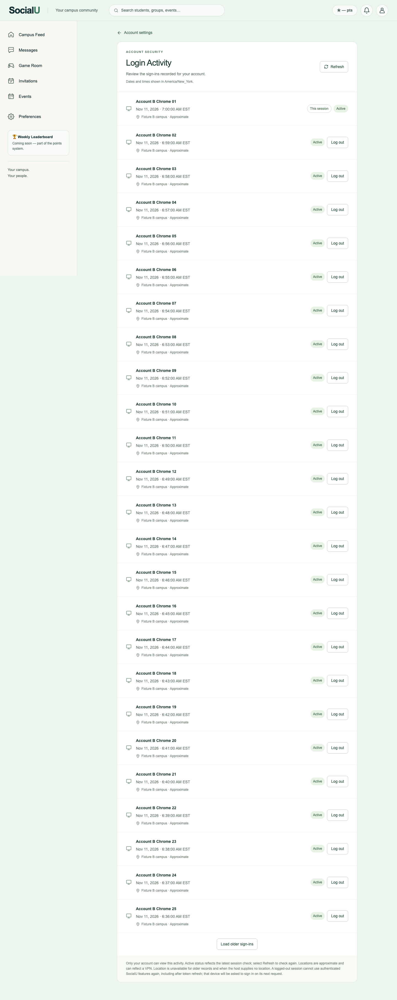
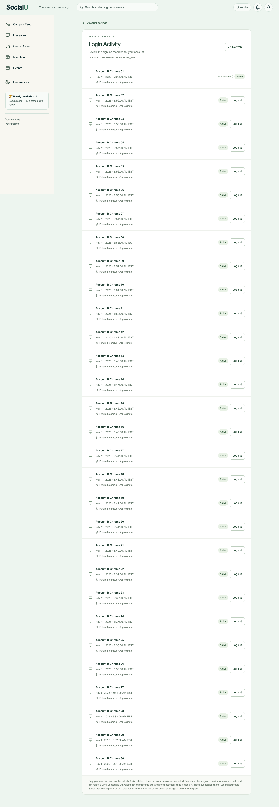

# Bug #1226: isolate Login Activity when the account changes

November 16, 2026. Owner: Linh Nguyen (`Dieulinhh23`). Severity: Major.

[Bug #1226](https://github.com/SonjaSeferasi/ssu-starter-app-v2/issues/1226) → [SRS-107.1 #858](https://github.com/SonjaSeferasi/ssu-starter-app-v2/issues/858) and [SRS-107.2 #859](https://github.com/SonjaSeferasi/ssu-starter-app-v2/issues/859) → UR-107. The existing SRS cards and their original implementation tasks were already completed; this change fixes the reported regression without reopening or recounting those tasks.

The branch `srs-107.1-107.2-fix-1226-account-history-isolation` was created from current main before coding. The follow-up PR links both SRS cards and closes only #1226. Evidence comments on each card link that PR and branch.

## What happened

Account A opened Login Activity with 25 records. Another tab signed in as account B with Remember me checked. The first tab kept A's rows and pagination cursor. Clicking Load older sign-ins sent that old cursor with B's new access token. The API correctly returned B's older records, but the screen appended them to A's list and skipped B's newer records.

The baseline test reproduced **25 A records plus B records 27–30**. The baseline request trace shows B receiving A's cursor `25`.

## What changed

`lib/account/login-activity-session.ts` subscribes to storage changes, same-tab session changes and focus. Its UI identity uses the effective token's account ID plus login-session ID, respecting the existing sessionStorage-before-localStorage rule. Refreshed tokens from the same login keep the same identity.

`components/account/login-activity.tsx` gives each identity its own component state. A change removes old records, pagination cursors, messages and logout selection together, then requests the new account's first page. Unmounting aborts obsolete history and logout requests. The request helper checks the token and current identity before sending a cursor/action and again after receiving JSON; old-account responses cannot populate the new list even if cancellation arrives too late.

Decoded claims are used only to partition UI state. The existing API still verifies tokens and authorizes database access. No database/schema migration was needed; the bug was in retained client state. The regression tests exercise the real API routes and existing SQL migrations.

## Verification

| Check | Observed result |
| --- | --- |
| Baseline against current main | Expected failure: 25 A rows remained; 4 B rows appended using A cursor |
| Remembered A → B in another tab | Same document; 25 B rows; first B request has no cursor |
| Pagination after switching | All 30 B records, descending timestamp order, no A records |
| Old logout selection | A confirmation closes on switching to B |
| Delayed A pagination response | Release after B loads; final list contains only B's 30 records |
| Same-session B token refresh | Existing 30 B records retained |
| Sign out | Previous records removed |
| Non-remembered A / remembered B | Original tab retains its own A session and all 30 A records |
| Focused unit/API/database suite | 89 tests passed in 9 files |
| Browser regressions | All 3 passed against a clean production build |
| Production build | Passed, including TypeScript validation |

[Executed account/request trace and source hashes](1226-evidence/account-switch-trace.json). [Pre-fix expected failure trace](1226-evidence/before-expected-failure.json). [Delayed response screenshot](1226-evidence/04-late-a-response-ignored.png). [Per-tab account screenshot](1226-evidence/05-per-tab-account-preserved.png).

The browser run uses the actual Next production UI and login/history API with the repository's actual SQL migrations in disposable PGlite. Only the Supabase Auth/PostgREST transport is supplied locally for the two disposable accounts. Fixture labels identify screenshots honestly. No hosted account history was inspected and no hosted sessions were ended. The source snapshot excluded unrelated workspace edits; its exact file hashes are in the trace.

To repeat: build a clean checkout with `npm run build`, install Playwright separately if needed, then set `SOCIALU_PLAYWRIGHT_MODULE` to its module path and `LOGIN_ACTIVITY_BROWSER_EXECUTABLE` to Chrome/Chromium. Run `npx vitest run --config vitest.login-activity-evidence.config.ts`. Optionally set `LOGIN_ACTIVITY_EVIDENCE_DIR` for output. Unit/API/database checks use `npx vitest run __tests__/login-activity-session.test.ts __tests__/account-session.test.ts __tests__/api/session.test.ts __tests__/api/login-activity.test.ts __tests__/api/auth.test.ts __tests__/login-session-options.test.ts __tests__/login-activity-format.test.ts __tests__/login-context.test.ts __tests__/database/login-activity.test.ts`.

## What to say in class

“My Login Activity page kept the previous account's records when another tab switched remembered accounts. It even used the previous account's pagination cursor. I made the page state belong to the current account and login session, clear it on a switch, and cancel or reject old requests. I tested two accounts with 30 records each: switching starts B from its first page, and loading older records shows all B records without any A records. I also checked delayed responses and per-tab logins. The API already enforced ownership, so this fix needed no database migration.”

For the demo, show bug #1226, its SRS links, this branch's merged PR, and the before/after screenshots. The automated two-account demonstration is repeatable using the script above. QA metrics should count this as one completed Major defect assigned to Dieulinhh23; use the actual merge/closure date when refreshing the team tables. This individual bug record does not replace the team's five QA metrics charts or Canvas submission.
