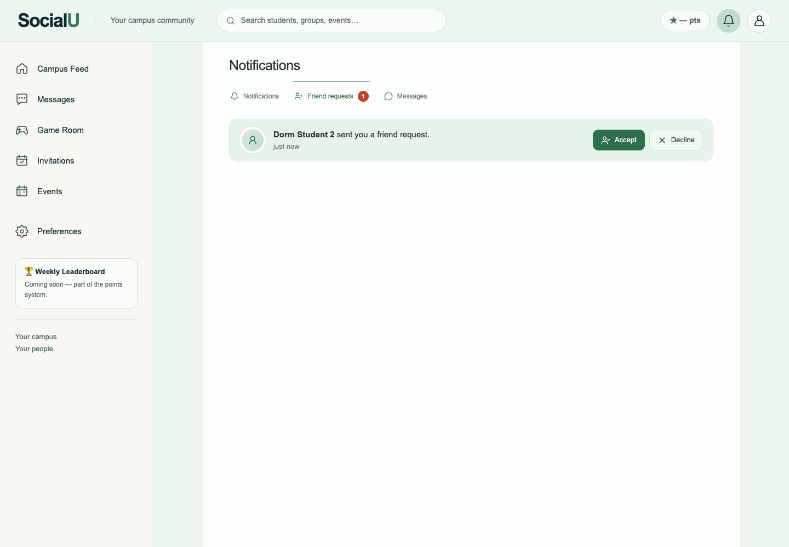
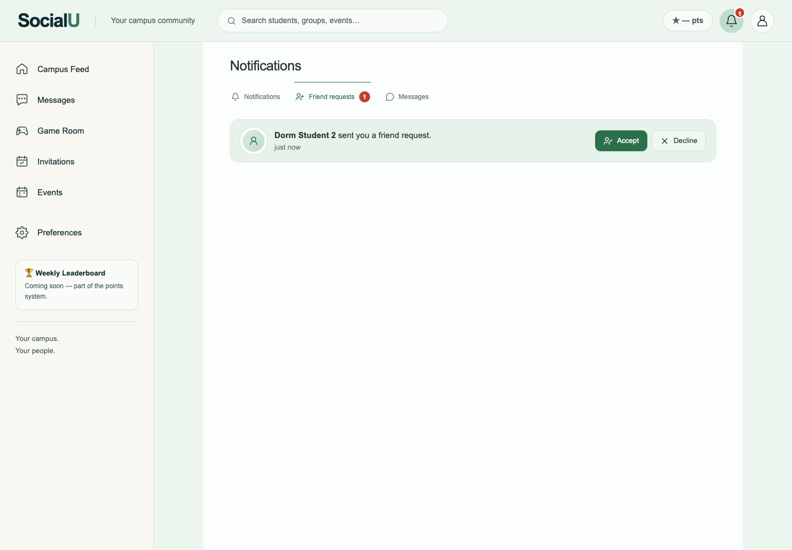
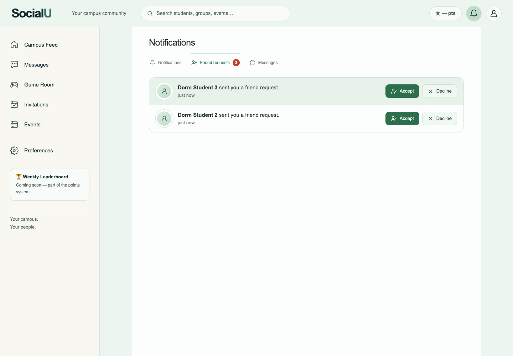

# #1227 — acknowledge only the displayed notification snapshot

November 16, 2026. Owner: Dieulinhh23 (Linh Nguyen). Severity: Major.

Bug #1227 → SRS-114.7 #506 → UR-114. Original read-state tasks: #509/#510. Branch `srs-114.7-fix-1227-notification-read-snapshot` was created before coding. The follow-up PR closes only the bug; the SRS's separate live-account acceptance remains open.

## Class explanation

“The page loaded notifications and then marked every notification read. A friend request arriving between those steps lost its unread badge even though I hadn't seen it. I changed the database response to include the exact notification IDs represented in the list. The page sends those IDs back, and the API marks only those rows read for the signed-in recipient. A later request stays unread and keeps the bell badge. Grouped likes include all of their underlying IDs so they still clear correctly.”

## Changes

The additive migration `20261116233000_notification_read_snapshot.sql` adds `read_ids` to the existing feed's item CTEs, including every row in a grouped-like item. It preserves the installed feed's visibility/school/Whisper logic by patching the existing definition with checked markers. The new service-role-only RPC acknowledges exact IDs, filters by verified recipient, leaves existing read timestamps intact, and returns the actual remaining unread count. No notification rows are changed by installing the migration.

POST `/api/notifications` now requires a bounded array of positive bigint ID strings; missing/malformed snapshots return 400 instead of marking everything read. The page posts only IDs from its loaded list, then tells the bell to refresh. The legacy service-only RPC is retained for compatibility but is no longer called by the production route.

## Executed evidence

The browser test pauses the acknowledgment request after GET, inserts a second friend request using real SQL, and then releases POST. Before the fix, POST had no body and returned unread 0; both rows were read. After the fix, POST sends only ID 1, returns unread 1, and the later row remains null/read-unset. Reloading makes the later request visible normally.

19 focused tests passed across API validation, snapshot race/grouped likes/owner isolation, unified notifications and friendship regressions. One actual production-app browser race regression passed; clean production build/TypeScript validation passed. [Before trace](1227-evidence/before-race-trace.json), [after trace](1227-evidence/race-trace.json), [source hashes and migration verification](1227-evidence/verification.json).

The migration was applied through the existing authorized Supabase project `sfrpokisjlwgknxlzllu`, recorded as version `20261116233000`, and verified with `snapshot_installed=true`, `owner_ack_installed=true`. No live notification records were marked read. Browser screenshots use disposable local accounts, actual Next UI/API and SQL; Auth/PostgREST transport is fixture-controlled. They do not claim a production two-account race. Unrelated workspace edits were excluded from the tested snapshot and commit.

Repeat tests with `npx vitest run __tests__/api/profile-notifications.test.ts __tests__/database/notification-read-snapshot.test.ts __tests__/database/notifications-unified.test.ts __tests__/database/friendships.test.ts`. For browser evidence, build first, set `SOCIALU_PLAYWRIGHT_MODULE` and `LOGIN_ACTIVITY_BROWSER_EXECUTABLE` to Playwright/Chrome paths, then run `npx vitest run --config vitest.notification-evidence.config.ts`.

For the demo: show #1227, SRS #506, the merged PR and both screenshots. Count one completed Major defect assigned to Dieulinhh23 using the actual closure date. This record does not replace the team's five QA metrics charts or their tables.
