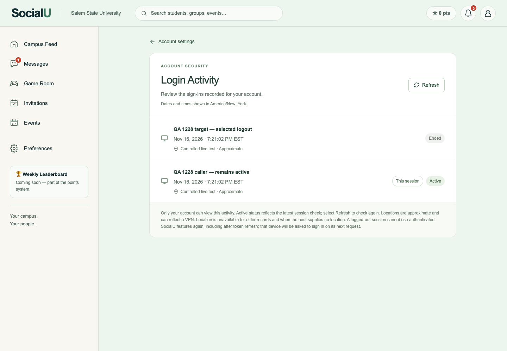

# #1228 — selected logout stops protected live updates

November 16, 2026 (Eastern). Owner: Dieulinhh23 / Linh Nguyen. Severity: Major (confirmed in owner triage).

Bug #1228 → SRS-107.8 #881 → UR-107. Follow-up branch `srs-107.8-fix-1228-realtime-session-revocation` was created before coding from current main. The PR closes only #1228; original SRS/task completion is a separate closeout, not silently asserted here. Chat is the affected integration transport, not a new defect assigned to its teammate.

## Class explanation

“Remote logout blocked normal app requests, but the old live-chat connection could still receive messages. Realtime remembers permission for an open connection, so changing only its policy would not fully fix it. I gave each login session its own private channel and made the server send only to currently allowed sessions. After logging out the target, its already-open connection received no new message, while my current session still received it and stayed signed in.”

## Fix

The additive migration `20261117010000_realtime_session_revocation.sql` replaces the old user-wide receive policy with a session-specific policy. It checks the JWT's user and session against active provider sessions, active/verified account state and the existing application revocation guard. Tokens cannot join another session's topic, including another session of the same user.

A service-only `socialu.send_to_active_sessions` helper checks eligibility at send time. Existing protected broadcast producers are redirected through it, covering text/emoji/photo messages, deletions, reactions, invitations and conversation updates. There are no user-wide fallback copies. Thus a revoked connection whose old permission remains cached receives no subsequent payload. The browser's shared channel now includes both user ID and session ID and replaces its channel when either changes.

[Supabase documents that channel permissions are cached until reconnect/token update](https://supabase.com/docs/guides/realtime/authorization). Server fanout is necessary to address existing connections rather than relying on a cooperative client refresh. Messages already queued before revocation cannot be recalled; the verification concerns new sends after the completed logout.

## Actual evidence

The screenshot is the actual local Next production Login Activity page connected to hosted Supabase using private disposable QA accounts. Device names identify the test roles deliberately; they are not real students' device histories.

| Check | Before | After |
| --- | --- | --- |
| Target application guard | Denied after logout | Denied |
| Target protected live authorization | Allowed despite logout | Denied |
| Old user-wide cached WebSocket | Received actual plain-text test message after logout | No new message after migration |
| Session-specific cached WebSocket | Caller and target both receive while active | Target receives no new message after logout |
| Target reconnect with revoked JWT | Old policy allowed own user topic | New session topic rejected |
| Caller | Still signed in | Receives new message and loads authenticated Login Activity |

[SQL authorization/fanout regression](1228-evidence/sql-trace.json), [live legacy rollout trace](1228-evidence/live-websocket-trace.json), [live session-specific before/after trace](1228-evidence/live-session-channel-trace.json), [source hashes, installation verification and limits](1228-evidence/verification.json).

The live checks use real Supabase Auth, real SQL functions, actual private WebSocket subscriptions, two login sessions for the receiver and a separate authorized participant sending plain text through `socialu_send_message`. The target socket remains open without a focus/session refresh. After observing caller delivery, the target is watched for another 2.5 seconds. A second run demonstrates both connections receiving on the new topics before logout, then only the caller afterward. A rejected revoked-token join and application guard checks independently confirm authorization. These are raw transport checks, not a claim that two physical laptops were used.

28 focused tests in six files passed, including new policy/fanout/client-channel tests and existing Login Activity/session/chat regressions. A clean production build and TypeScript validation passed. Snapshot source hashes match the tested files; unrelated workspace edits are excluded.

## Installation, deployment and limits

Installed and recorded migration version `20261117010000` in authorized project `sfrpokisjlwgknxlzllu`. Verification returned `session_policy_installed=true`, `session_topic_installed=true`, `legacy_producers_removed=true`. Installation itself logs out no ordinary users and changes no login-history rows. Already-open clients using the retired user-wide topic should reload after the frontend deployment to resume live delivery on their session topic.

A deployed-app authenticated API attempt returned **503: Authentication is unavailable. Check the server Supabase configuration.** Full live acceptance therefore used the configured local production UI/API with the real hosted Auth/SQL/Realtime service. A successful Vercel deployment must not be represented as a fix for that separate environment configuration. The historical Supabase automatic migration-version mismatch is likewise separate from this manually installed/recorded migration.

The initial environment probe and two live test runs created six private synthetic accounts in total. All were deactivated and their application sessions revoked after testing. Synthetic records remain for audit; physical account/message deletion is not claimed. No existing student's sessions were ended, and no messages were sent to existing users.

Repeat deterministic checks with `npx vitest run __tests__/realtime-session-channel.test.ts __tests__/database/realtime-session-revocation.test.ts __tests__/database/login-activity.test.ts __tests__/api/login-activity.test.ts __tests__/api/session.test.ts __tests__/database/chat.test.ts`. To repeat the live test after migration, build a clean checkout, configure `.env.local`, then explicitly set `RUN_LIVE_REVOCATION_TEST=yes`, `SOCIALU_PLAYWRIGHT_MODULE` and `REVOCATION_BROWSER_EXECUTABLE` and run `node scripts/tests/realtime-session-revocation.live.cjs`. This creates and deactivates two private disposable accounts. Optional `REVOCATION_APP_ROOT` selects a clean build and `REVOCATION_EVIDENCE_DIR` selects output. The test uses local port 3128.

For class, show #1228, SRS #881, the merged PR, the screenshot and both live traces. QA metrics count one completed Major defect assigned to Dieulinhh23 using its actual closure date and the team's stated timezone. This evidence record does not replace the team's five metrics charts/tables or demo attendance.
