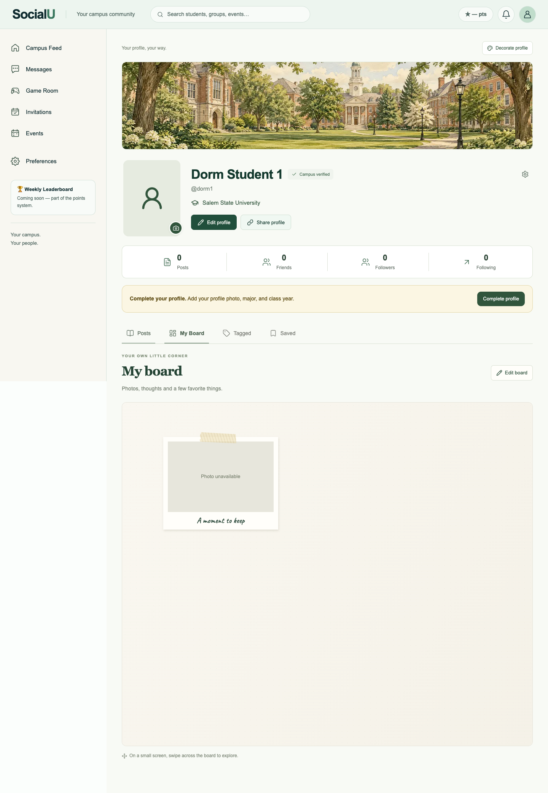
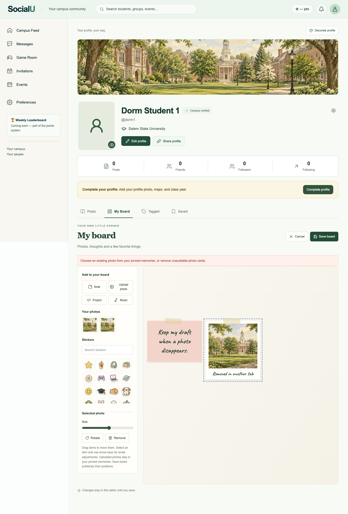
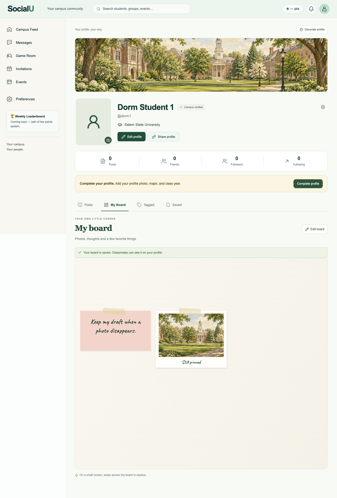

# #1229 — require existing owner photos on My Board

November 16, 2026 (Eastern). Owner: Linh Nguyen / Dieulinhh23. Severity: Minor.

Bug #1229 → SRS-124.1 #1038 → UR-124; original data/API tasks #1039/#1040. The follow-up branch `srs-124.1-fix-1229-board-photo-ownership` was created before coding and contains the actual fix. This PR closes only the bug; the SRS's remaining acceptance/review and original task closeout are not silently marked complete.

## Class explanation

“The board checked that a photo ID was a positive number, but not that it existed or belonged to me. That allowed broken photo cards to save. I added a database check that accepts only existing photos from the board owner's pinned memories. Missing, removed and other students' IDs now return a clear validation error. The editor keeps the draft, so I can replace the photo and save without losing my note.”

## What changed

The additive migration `20261117020000_board_photo_ownership.sql` installs a trigger on `socialu.profile_spaces` inserts and look updates. For every photo card it checks a positive safe-integer memory ID, verifies a matching `profile_memories` row owned by the board's `student_id`, and holds a key-share lock on that row through commit. This closes the validation/deletion race at save time; it does not prevent intentional removal after a completed save.

The database boundary covers both the atomic board-only save from #1223 and full-look saves, so PUT or another persistence path cannot bypass ownership checks. The existing route already maps PostgreSQL `22023` to HTTP 400, and the existing editor already preserves drafts on failed saves; no production TypeScript change was needed. A new API regression verifies that error mapping.

The migration does not rewrite or delete existing boards/photos. Older invalid boards are not silently repaired: the next look save must remove or replace their unavailable photo cards. The error instructs the owner how to recover. No foreign image disclosure was demonstrated; this remains the reported Minor data-validation defect.

## Running-application evidence

The browser test opens a real board editor and a second profile tab. It adds an unsaved note and photo, then uses the authorized memory DELETE endpoint in the second tab. The first editor's stale shelf still contains that photo. Save now returns 400, keeps both draft cards and leaves the stored board unchanged. Removing that card, choosing a still-pinned owner photo and saving returns 200; reload restores both the note and valid photo.

| Case | Before | After |
| --- | --- | --- |
| Missing positive ID | HTTP 200, persisted | HTTP 400, prior board unchanged |
| Another student's memory ID | HTTP 200, persisted | HTTP 400, prior board unchanged |
| Photo removed in another tab | HTTP 200, persisted | HTTP 400, draft retained |
| Valid owner photo | Accepted | Accepted and restored after reload |
| Full-look bypass attempt | Unchecked photo IDs | Database rejects it |
| No-photo / empty board | Accepted | Accepted |

52 focused tests passed across API, board contract, atomic-save and photo-ownership database tests. One full production-app browser regression passed; the pre-fix run failed as expected because it returned 200 instead of 400. A clean production build and TypeScript validation passed. [Before trace](1229-evidence/before-photo-trace.json), [after trace](1229-evidence/photo-trace.json), [tested-source hashes and migration verification](1229-evidence/verification.json).

The screenshot uses the actual local Next production UI/API and actual SQL/migrations on disposable PGlite. Auth/PostgREST and media-signing transport are fixtures; the test image is an existing public campus artwork asset, not a real student's private photo. This is not claimed as hosted two-account photo acceptance. No hosted student's board, photo or session was changed. Unrelated workspace edits were excluded from the clean source snapshot and commit.

## Installation and repeat checks

The migration was applied in authorized Supabase project `sfrpokisjlwgknxlzllu` and recorded as `20261117020000`. Verification returned `photo_guard_installed=true` and `migration_recorded=true`. Before execution, the actual editor model was read back and verified against the exact migration/history SQL; its SHA-256 is in the verification record.

Repeat focused checks: `npx vitest run __tests__/api/profile-space.test.ts __tests__/profile-board.test.ts __tests__/database/board-photo-ownership.test.ts __tests__/database/profile-board-atomic-save.test.ts`. For browser evidence, build a clean checkout, set `SOCIALU_PLAYWRIGHT_MODULE`, `BOARD_BROWSER_EXECUTABLE` and optionally `BOARD_EVIDENCE_DIR`, then run `npx vitest run --config vitest.board-photo-evidence.config.ts`. `BOARD_PHOTO_BASELINE=yes` omits this migration and demonstrates the expected pre-fix failure.

The deployed app's authentication-configuration error and historical automatic Supabase migration-version mismatch documented during #1228 remain separate environment findings. Successful deployment does not establish authenticated production acceptance; this record states exactly where the full behavior was tested.

For the demo, show #1229, SRS #1038, the merged PR, the error/draft screenshot and successful recovery screenshot. QA metrics count one completed Minor defect assigned to Dieulinhh23 using its actual closure date and the team's timezone. This record does not replace the team's five metrics charts/tables or Canvas submission.
