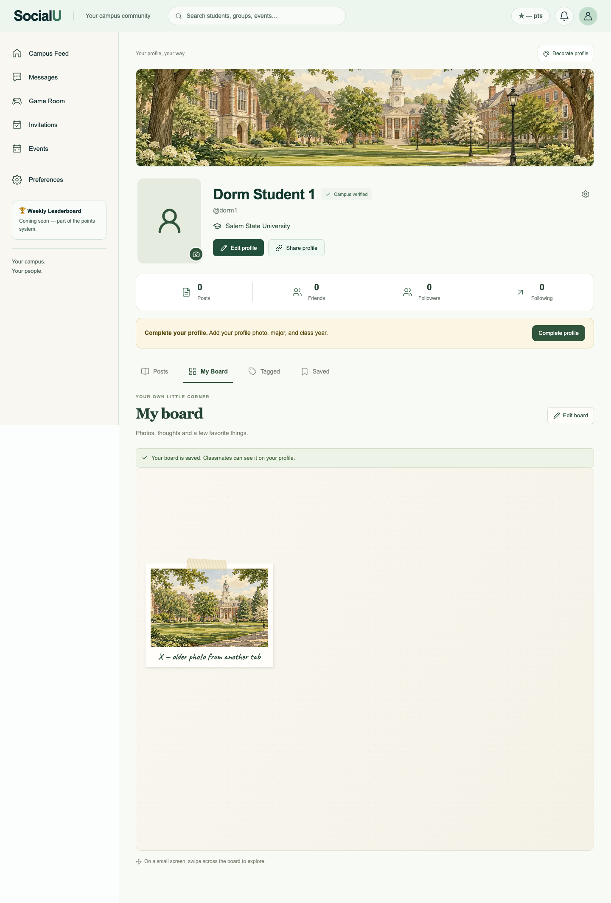
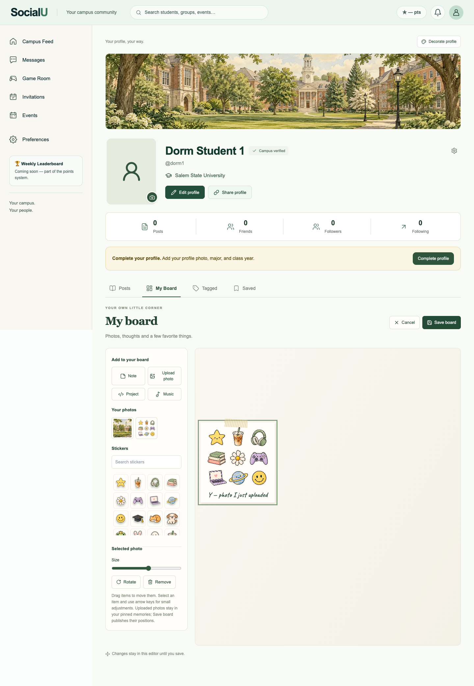
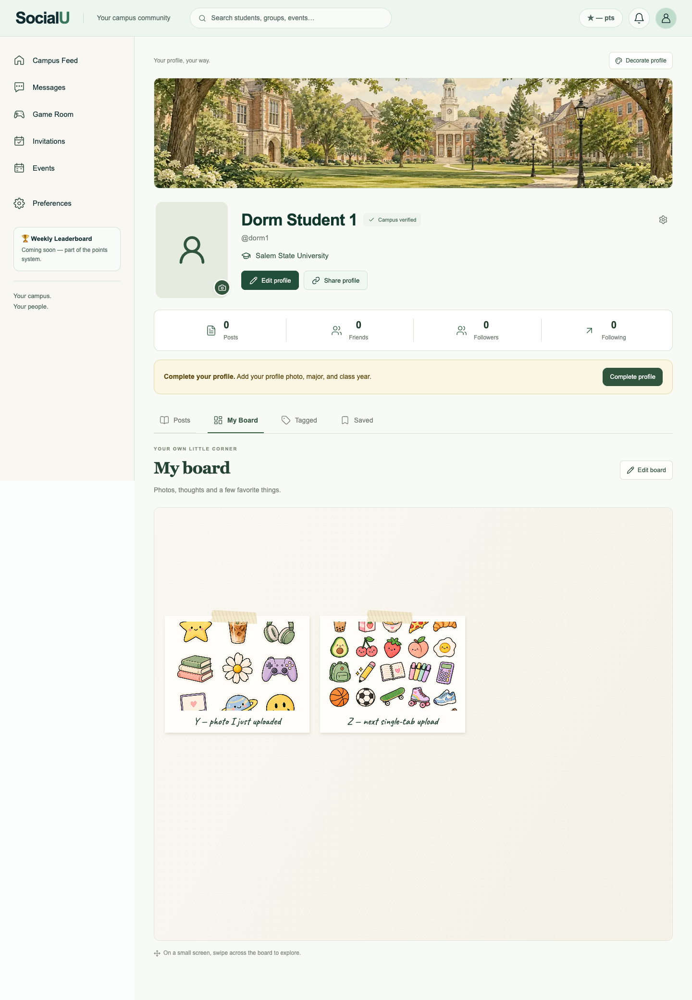

# #1230 — insert the exact photo just uploaded

November 16, 2026 (Eastern). Owner: Linh Nguyen / Dieulinhh23. Severity: Major.

Bug #1230 → SRS-124.1 #1038 → UR-124; original editor task #1041. The SRS-named branch `srs-124.1-fix-1230-uploaded-photo-identity` was created before coding and contains this actual fix, tests and evidence. The follow-up PR closes only #1230; the parent's remaining acceptance/review and original task closeout remain separate.

## Class explanation

“The board guessed which photo was new by comparing the returned list with its old photo cache. If another tab uploaded X before I uploaded Y, both looked new and it picked X. I changed the API to return the exact ID of the file just uploaded, then passed that ID directly to the board. The test now inserts Y even with a stale tab, saves Y's ID, and restores the correct photo after reload. A normal single-tab upload still works.”

## Changes

POST `/api/profiles/memories` already creates a unique server-generated storage key and receives the owner's memory rows from the actual SQL add operation. It now matches that exact key to the new row and returns its safe numeric `createdMemoryId` alongside the existing signed photo list. It does not guess from array order, timestamps or the client's old cache. Storage keys remain server-side metadata; GET/DELETE response shapes are unchanged. No database migration is necessary.

`MemoryEditor` validates the explicit ID, confirms it is present in the returned list and passes it to its callback. `ProfileBoard` inserts that ID directly while refreshing the shelf from the full returned list. The ordinary pinned-memory component can continue using the list alone.

If the created identity cannot be confirmed, the API/editor report a clear error instead of selecting another photo. Once the database pin has committed, its media is not deleted because of a later confirmation failure. The existing cleanup still removes an upload when the pin operation itself fails.

## Executed evidence

The actual browser test keeps board tab A mounted with an empty photo cache. Tab B uploads distinct PNG X through the normal pinned-memory dialog. Tab A then uploads distinct PNG Y through Upload photo. The SQL response is oldest-first, `[X,Y]`.

Before: the board inserted X and persisted memory ID 1 although Y's ID was 2. After: the API returns createdMemoryId 2; the same mounted board inserts Y and Save board persists 2. A subsequent single-tab upload Z returns 3 and the saved board contains `[2,3]`; reload renders both Y and Z. All three uploaded byte streams have distinct SHA-256 hashes in the trace.

| Check | Result |
| --- | --- |
| Pre-fix stale A / other-tab X / new Y | Expected regression failure: X inserted and ID 1 saved instead of ID 2 |
| Fixed stale A / other-tab X / new Y | Y inserted in the same mounted document; explicit/saved ID 2 |
| Next single-tab upload Z | Z inserted; final saved IDs `[2,3]` |
| Fresh reload | Both correct images and captions render; loaded image dimensions verified |
| Exact file bytes | Three distinct actual uploaded PNG hashes recorded |
| API unit checks | Exact key identity despite an earlier new row, single-tab identity, unchanged GET shape, upload failure cleanup and fail-closed confirmation |
| Focused suite | 64 tests passed in four files |
| Actual-app browser regression | Passed, covering both acceptance cases and reload |
| Clean production build | Passed, including TypeScript validation |

[Before request/selection trace](1230-evidence/before-upload-trace.json), [after trace and image hashes](1230-evidence/upload-trace.json), [tested-source hashes](1230-evidence/verification.json). [Saved-Y screenshot](1230-evidence/02-board-saved-y.png).

The screenshots show the actual local Next production UI/API with the repository's actual SQL and the #1229 ownership guard in disposable PGlite. Auth/PostgREST/private storage transport is fixture-controlled; storage retains and serves the actual PNG bytes submitted through the upload dialog. The three test images are existing public campus artwork assets with explicit X/Y/Z captions, not real student photos. The corrected fixture verifies images load visibly before capture. No hosted student's board, photo or account was changed. Unrelated workspace edits were excluded from the clean tested snapshot and commit.

## Repeat checks and demo

Run `npx vitest run __tests__/api/profile-memories.test.ts __tests__/database/profile-memories.test.ts __tests__/profile-board.test.ts __tests__/api/profile-space.test.ts`. For browser evidence, build a clean checkout, set `SOCIALU_PLAYWRIGHT_MODULE`, `BOARD_BROWSER_EXECUTABLE` and optionally `BOARD_EVIDENCE_DIR`, then run `npx vitest run --config vitest.board-upload-evidence.config.ts`.

For class, show #1230, SRS #1038, the merged PR, the before/after screenshots and the saved IDs in the trace. Reload the app after deployment to use the updated upload callback. QA metrics count one completed Major defect assigned to Dieulinhh23 using the actual GitHub closure date and the team's timezone. This record does not replace the team's five QA metrics charts/tables or remaining SRS review.

The independently observed deployed authentication configuration issue and historical automatic Supabase migration-version mismatch remain separately documented in earlier fixes. A successful Vercel deployment is not a claim of hosted authenticated upload acceptance; full behavior was tested in the environment stated above.
