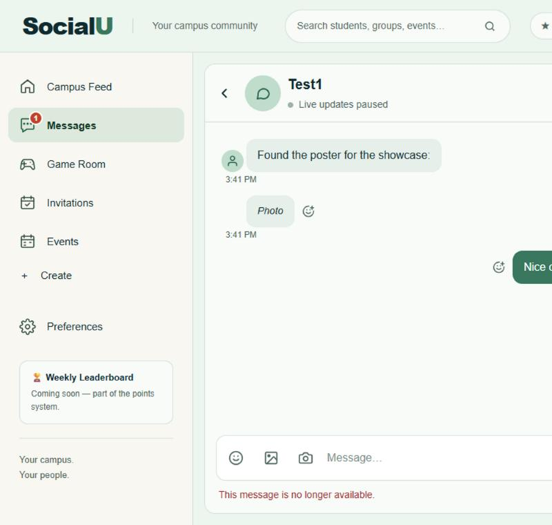
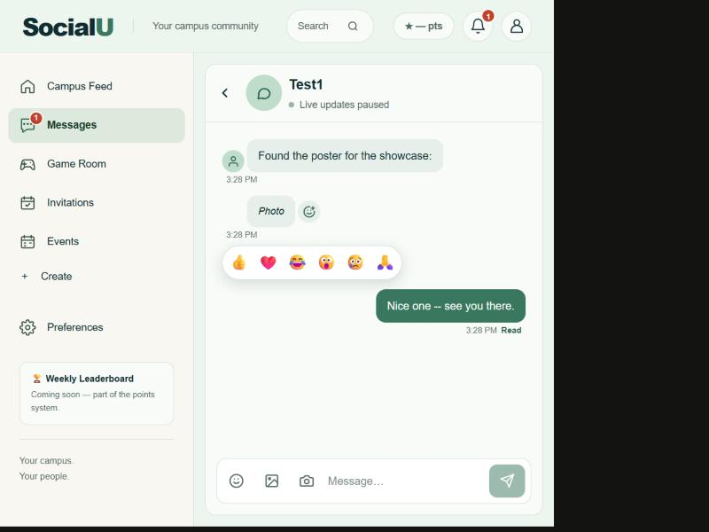
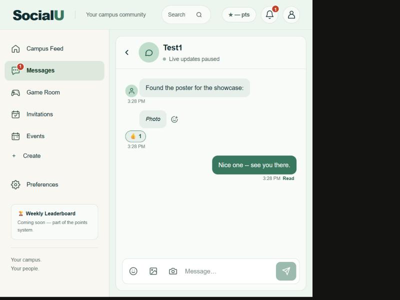

# Bug #1262 — a participant could not react to a photo

Owner: Loens Paul / bosspml. Severity: Minor (missing capability, no data loss).
Requirement: SRS-210.1.
Branch: `srs-210.1-react-to-a-photo`, merged in
[#1285](https://github.com/SonjaSeferasi/ssu-starter-app-v2/pull/1285).
Migration: `20261117040000_chat_react_to_photo.sql` (SHA-256 `c5b4a9c…`).

**This duplicates [#1173](https://github.com/SonjaSeferasi/ssu-starter-app-v2/issues/1173)**, filed
earlier by marcos-j-salazar, which was still open and unassigned. I filed #1262 without searching
first — my miss, recorded here so the board history reads honestly. The fix below closes both.

## Explanation for class

"SRS-210.1 says a participant may pick *an existing message* and react to it. It puts no condition on
what kind of message that is. `socialu_react_to_message` and `socialu_remove_reaction` were written
on 26 October against the two kinds that existed then — text and emoji. Photos arrived afterwards,
under SRS-201.6 and SRS-201.7, and nobody went back to those two functions. So reacting to a photo
answered `SCR04`, 'no such message'."

Nobody ever saw an error, which is why this sat unnoticed: the page **hid** the React button on
photos, precisely because the call would have failed. The hidden button was the symptom. The refused
write was the cause.

## What was in the report and what was not

The issue also named the kind filter in `20261027120200`. That is the *original*
`socialu_conversation_messages` and it has been superseded three times since. What actually runs
builds its rows from `kind IN ('text','emoji','photo')` and computes reactions from them, so the
history half has worked since #1217. Only the two write paths needed widening. Corrected on the
issue.

## What my own test caught

Admitting photos also admits **deleted** ones, which the old filter excluded by accident rather than
on purpose: #1106 leaves a removed photo in place as a tombstone, still `sent` and still kind
`photo`. Adding a reaction now requires the message not to be in `socialu.deleted_messages`.

Removing one deliberately does **not** carry that guard. A student who reacted before the photo was
removed must still be able to take that reaction back, rather than be stuck with one on a tombstone.
That asymmetry is the point, and it was not in the report.

Neither function calls `socialu.is_blocked` or `realtime.send`, so neither the school-community
rewrite nor the session-revocation rewrite has anything to lose here.

## Verified evidence

Taken November 18, 2026 against `scripts/tests/chat-evidence-fixture.mjs` — the real Next UI and the
real API routes over the real migrations in a disposable in-memory PGlite database. Only Supabase's
Auth and PostgREST transport is replaced. **The hosted database is never contacted.**

Both runs use the same seed and the same client build. Only the migration differs — the `--without=`
flag added on the evidence branch drops a named migration:

```
node scripts/tests/chat-evidence-fixture.mjs --without=20261117040000   # before
node scripts/tests/chat-evidence-fixture.mjs                            # after
```

Loens is signed in. Conversation `1` is a DM with Test1 holding a text message and a photo.

### Before — the same emoji, the same conversation, two different answers



Clicking a reaction on the photo produces **This message is no longer available.** in red under the
composer. `1262-evidence/reaction-trace.json` records the calls behind it:

| message | before |
| --- | --- |
| `3` — the photo | 404 `This message is no longer available.` |
| `1` — a text message in the same conversation | 200, reaction applied |

The client in this run is the **fixed** client, which is why the React button is offered on the photo
at all. On the client as it stood before #1262 the button was not there to click. Both halves — the
hidden control and the refusal underneath it — are what the fix removes.

### After — the reaction set opens on a photo



👍 ❤️ 😂 😮 😢 🙏 — the approved set, unchanged, offered on a photo like any other message.

### After — the reaction is applied and reads back



The `👍 1` chip sits under the photo. Read back from the API immediately afterwards:
`{"appliedTo":"3","reactionsOnPhoto":[{"count":1,"emoji":"👍","mine":true}]}` — it is in the
database, not only on the screen.

## Tests

`__tests__/database/react-to-photo.test.ts` — one scenario over the migration in PGlite covering
apply, change, remove, the history round trip, and the rules that did **not** move: the approved-emoji
set, the outsider's answer, and both halves of the tombstone asymmetry (a deleted photo refuses a new
reaction, and still allows an existing one to be removed).

38 tests green across 7 chat files at the time of merge.

## Hosted migration

`20261117040000` was applied to the hosted project and recorded: read-only probe, SHA-256 of the
editor content checked against the committed file (`c5b4a9c…`), a dry run inside a rolled-back
transaction, the rollback verified clean, then applied and verified — both write paths widened, the
tombstone guard present on the add path and absent on the remove path, and nothing granted to `anon`
or `authenticated`.
