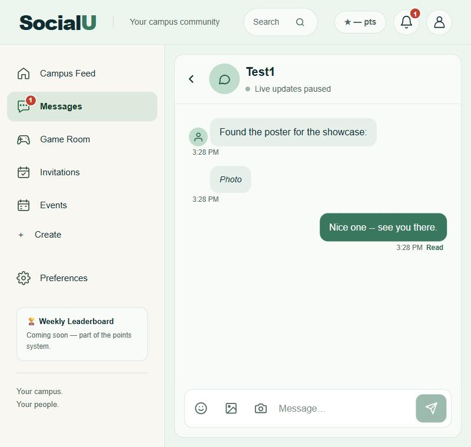

# SRS-211.3 — show when each message was sent

Owner: Loens Paul / bosspml.
Requirement: SRS-211.3 ([#1281](https://github.com/SonjaSeferasi/ssu-starter-app-v2/issues/1281)),
with the placement refined afterwards.
Branches: `srs-211.3-display-message-time`, merged in
[#1298](https://github.com/SonjaSeferasi/ssu-starter-app-v2/pull/1298); and
`srs-211.3-time-below-the-message`, merged in
[#1342](https://github.com/SonjaSeferasi/ssu-starter-app-v2/pull/1342).
No migration — this is entirely client-side.

## Explanation for class

"`socialu_conversation_messages` has always returned `sent_at`, and the page already used it — but
only to sort. Nothing was ever rendered, so a message inside a conversation carried no time at all,
while the Messages list showed one per conversation row."

## Why the list's rule was not reused

`shortTime` in `conversation-list.tsx` shows the clock time for today and the date otherwise. That is
right for a **list**, where each row is one conversation and the question is "when did this last
happen".

It is not enough **inside** a conversation, which can run across days. A bare `9:15` on a message
from last week reads as today. So `lib/chat-time.ts` always shows the clock time, adds the date when
the message is not from today, and adds the year as well when it is not from this year.

```ts
messageTime(value, now)          // '3:28 PM' · 'Nov 12, 3:28 PM' · 'Nov 12, 2025, 3:28 PM'
messageTimeFull(value)           // 'Wednesday, November 18, 2026 at 3:28 PM'  -> title
messageDateTimeAttribute(value)  // ISO instant                                -> <time dateTime>
```

The short label is for glancing at. `dateTime` carries the exact instant in ISO and `title` spells out
the weekday and full date for anyone asking "when exactly". The locale is passed as `[]`, so every
student sees the time in **their own** locale and timezone rather than the server's.

A message with a missing or unparseable `sent_at` shows **nothing**, rather than `Invalid Date`.
History always has one, but a live event is assembled in the browser and might not.

## The placement, and the change to it

#1281 put the time inside `bubbleRow`, which already reverses for the student's own messages, so the
time sat on the outer edge either way. LP asked for it **below** the message instead, and #1342 moved
it: it now closes the message rather than sitting beside it, so reaction chips stay attached to the
bubble they belong to and the time reads as the message's footer. The list already aligns its children
to the student's own side or the other's, so the time follows the bubble above it without needing a
rule of its own.

What the time *says*, and how it is announced, did not change. `lib/chat-time.ts` was untouched by
#1342 and its 7 tests still pass.

It is `aria-hidden` where it is drawn, because the bubble already speaks the time to a screen reader
*after* the sender and the text — which is where it belongs — rather than before them.

Contrast 5.9:1 on white and 5.5:1 on the panel, the same colour as the sender name above it.

## Verified evidence

Taken November 18, 2026 against `scripts/tests/chat-evidence-fixture.mjs` — the real Next UI and the
real API routes over the real migrations in a disposable in-memory PGlite database. Only Supabase's
Auth and PostgREST transport is replaced. **The hosted database is never contacted.**



Loens is signed in, in a DM with Test1. All three messages — two from Test1, including a photo, and
one of Loens's own — carry `3:28 PM` below them, received on the left and the student's own on the
right, following the bubble above. The fixture seeds everything in the same moment, so the short form
here is the clock time alone; the accessible text under each bubble reads *sent Wednesday, November
18, 2026 at 3:28 PM*, which is the `title`/`dateTime` pair doing its job. (The `Read` label beside
the last time is SRS-211.8, recorded separately in `1283-private-read-status.md`.)

There is no "before" screenshot for this item, and the reason is worth stating plainly: the time is a
**client** feature, not a database one. The evidence fixture can leave a migration out, but it always
serves the current page code, so a before run would still draw the time. The absence of a time before
#1281 is visible in the diff — `app/messages/[conversationId]/page.tsx` had no `<time>` element at
all — not in a screenshot the fixture can take.

## Tests

`__tests__/chat-time.test.ts` — 7 tests: the three display cases (today, this year, an earlier year),
the rule that a usable timestamp always produces a clock time, and the four unusable inputs
(`undefined`, `null`, an empty string, and text that is not a date) each producing an empty string
rather than `Invalid Date`.
