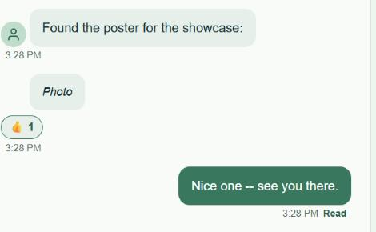
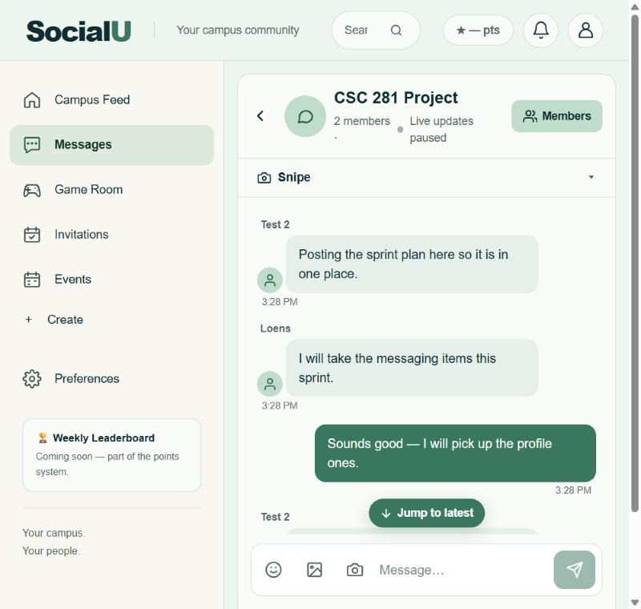

# SRS-211.8 / SRS-211.9 — tell a sender their private message has been read

Owner: Loens Paul / bosspml.
Requirement: SRS-211.8 ([#1283](https://github.com/SonjaSeferasi/ssu-starter-app-v2/issues/1283)),
with SRS-211.9 as its boundary.
Branch: `srs-211.8-display-private-message-read-status`, merged in
[#1355](https://github.com/SonjaSeferasi/ssu-starter-app-v2/pull/1355).
Migration: `20261117160000_chat_private_read_status.sql` (SHA-256 `cd84495…`).

## Explanation for class

"The data has been there the whole time. `message_reads` records who has read what.
`socialu_mark_conversation_read` writes to it when you open a conversation (SRS-212.5) and while you
are watching one (SRS-212.6). The unread dot in the Messages list (SRS-212.4) already reads from it.
What was missing is the other direction — the person who **sent** the message was never told."

## Three things it deliberately does not do

**It says whether, never when.** `read_at` is on the row and is left there. *Read at 11:42pm* is a
different and far more exposing claim than *Read*, and SRS-211.8 asks only for the status.

**It is confined to the sender's own messages.** A student learns whether the person they wrote to has
read them; nobody learns what anyone else has read. A received message carries no field at all.

**Nothing is shown before a message has been read.** Saying *Sent* there would be SRS-211.4, which is
a separate requirement and is not built. Silence is the honest state until it is.

## SRS-211.9 falls out of the same clause

```sql
|| CASE WHEN c.kind = 'private' AND m.sender_id = me
        THEN jsonb_build_object('read', EXISTS (...))
        ELSE '{}'::jsonb END
```

A group never satisfies `c.kind = 'private'`, so a group message carries no `read` field at all. That
matters: **absent and false are different answers**, and only *absent* is right for a group, where
"has it been read" has no single answer.

`showsReadReceipt` in `lib/chat-read-status.ts` repeats the private-only rule in the page, so the page
does not depend on the server alone, and so an absent field reads as "nothing to show" rather than
"not read" — which is what a browser talking to a server **without** `20261117160000` would see.

*Read* sits beside the time below the message, which is where it belongs now that #1342 moved the time
there. Green rather than grey, so it reads as a state reached rather than as more metadata: 7.0:1 on
white, 6.6:1 on the panel.

## Verified evidence

Taken November 18, 2026 against `scripts/tests/chat-evidence-fixture.mjs` — the real Next UI and the
real API routes over the real migrations in a disposable in-memory PGlite database. Only Supabase's
Auth and PostgREST transport is replaced. **The hosted database is never contacted.** The fixture
seeds a message from the signed-in student and a read of it, so the receipt has something to report.

### The receipt, on the sender's own message only



Loens is signed in, in a DM with Test1. Loens's own message reads `3:28 PM  Read`. The two messages
*from* Test1 above it carry a time and nothing else — Loens is not told what Loens has read.

### Nothing in a group, for anybody



The same build, in the `CSC 281 Project` group, seen by Test1. Test1's own message carries `3:28 PM`
and no receipt, because SRS-211.9 says a group message does not get one.

### The field itself, per viewer

`1283-evidence/read-field-per-viewer.json` — the same private conversation read by both students:

| message | sender | as Loens | as Test1 |
| --- | --- | --- | --- |
| 1 | Test1 | *absent* | `read: true` |
| 3 | Test1 | *absent* | `read: true` |
| 4 | Loens | `read: true` | *absent* |

Every message in group conversation `3` carries no `read` field for anyone, including the viewer's own.
`read_at` appears nowhere in any response.

## Tests

- `__tests__/chat-read-status.test.ts` — 7 tests for the display rule and the wording: group returns
  false, a received message returns false, a missing `read` returns false, a `read: false` returns
  false, and only a private message of your own with `read: true` shows the label.
- `__tests__/database/private-read-status.test.ts` — one database scenario for the private round trip,
  the recipient's view of the same conversation, the group, and that `read_at` never leaves the server.

53 tests green across 10 chat files at the time of merge.

## Hosted migration

`20261117160000` was applied to the hosted project and recorded: read-only probe, SHA-256 of the
editor content checked against the committed file (`cd84495…`), a dry run inside a rolled-back
transaction, the rollback verified clean, then applied and verified — the `read` clause present and
private-only, `read_at` not exposed, and nothing granted to `anon` or `authenticated`.
