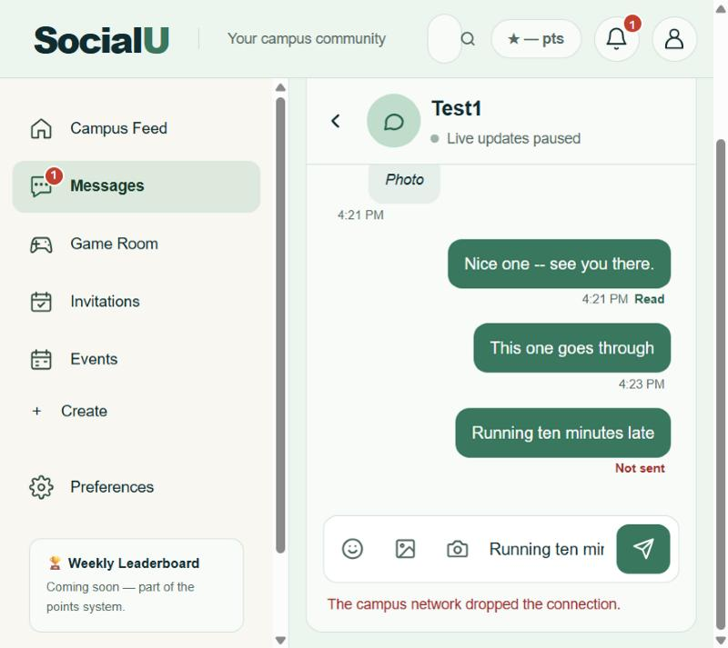
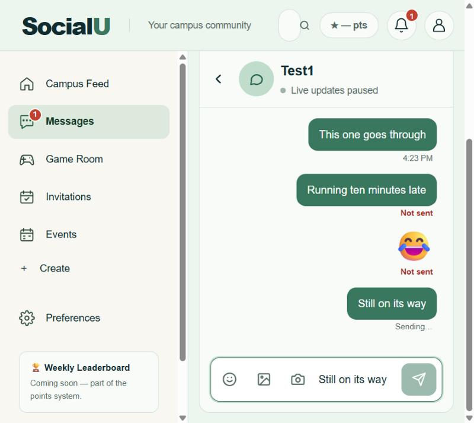

# SRS-201.16 — display a failed status on the message that did not go

Owner: Loens Paul / bosspml.
Requirement: SRS-201.16 ([#1368](https://github.com/SonjaSeferasi/ssu-starter-app-v2/issues/1368)).
SRS-211.5 ([#1369](https://github.com/SonjaSeferasi/ssu-starter-app-v2/issues/1369)) states the same
behaviour from the UR-211 side and is tracked under its own number.
Branch: `srs-201.16-display-failed-message-status`.
No migration — this is entirely client-side.

## Explanation for class

"When a send failed, one red line appeared under the message box — *Your message could not be sent* —
and that was all. The message itself never appeared anywhere. SRS-201.16 does not ask for an error
message; it asks for **a failed status for that message**, which means there has to be a message for
the status to be attached to."

So a message now goes into the conversation the moment the student sends it, before the server has
been asked. While the send is in flight it reads **Sending…**; if the server refuses, it stays where
it is and reads **Not sent**.

## What a local message is, and what it is not

Nothing here is written to the database, and no other participant ever sees it. It is one student's
own view of their own unsent message, living in their browser for as long as they have the
conversation open.

Because of that, `lib/chat-send-status.ts` keeps three rules the page cannot forget:

**It has a local id.** Server ids are numeric strings; a local id is `local:<n>`. Neither can be
mistaken for the other in either direction.

**Nothing can be done to it.** `canActOnMessage` is false for a local message, so no React button and
no Reply button appears on it. Reacting, replying, deleting and marking read all name a message by its
id, and a local id names nothing the server knows. Trying would fail, which is exactly the mistake
#1262 was: a control offered for a call that cannot succeed.

**The status is honoured only on a local id.** `status` is not part of the message shape the server
sends, but a received message must never be able to show its reader a status that is not theirs. A
message with a server id and a `status` field claiming `failed` is told nothing — there is a test for
that.

## Two details worth stating

**An unsent message carries no time.** A message that has not been sent has no sent time, and showing
one would be a small lie. The browser's clock is on it so that it sorts, and the sort is why:
`compareMessages` puts anything local after everything saved *before* it looks at a timestamp at all,
because a browser clock running behind the server's would otherwise drop an unsent message into the
middle of the conversation.

**The status shares the read receipt's slot.** `Sending…` and `Not sent` appear where `Read`
(SRS-211.8, #1283) appears, and the page shows one or the other, never both. They are states of one
slot rather than labels that can stack — which is also how SRS-211.4's `Sent` will join them.

## Still to come, deliberately

The message box is **not** cleared when a send fails, so the text is in the box and on the failed
bubble at the same time. That is visible in the first screenshot below and it is not an oversight:
clearing the box, and making the failed message the one place that content lives, is SRS-201.17
([#1370](https://github.com/SonjaSeferasi/ssu-starter-app-v2/issues/1370)). The **Retry** control is
SRS-201.18 ([#1371](https://github.com/SonjaSeferasi/ssu-starter-app-v2/issues/1371)). One SRS item
per branch.

The red line under the message box stays. It says *what went wrong*, in the server's own words; the
status on the message says *which message it was*. They answer different questions.

## Colours

`Sending…` is `#536963`, the same grey as the time beside it, because it is a passing state and should
not pull the eye. `Not sent` is `#a32d2d`, the colour the message box already uses for errors, so a
failure reads the same wherever it appears. 5.9:1 and 7.1:1 on white, 5.6:1 and 6.8:1 on the panel —
both AA.

## Verified evidence

Taken November 18, 2026 against `scripts/tests/chat-evidence-fixture.mjs` — the real Next UI and the
real API routes over the real migrations in a disposable in-memory PGlite database. Only Supabase's
Auth and PostgREST transport is replaced. **The hosted database is never contacted.**

The failure itself is produced in the browser, by replacing `window.fetch` so that `POST
/api/conversations/1/messages` answers `502` with
`{"error":"The campus network dropped the connection."}`. Everything else — the page, the API routes,
the database — is the real thing. A send cannot be made to fail from the outside on demand, and a fake
server would have proved less: this way the only thing that is not real is the network.

### A failed message, and the error line that stays

`Running ten minutes late` is in the conversation, on the student's own side, with **Not sent** below
it and no time. `Nice one -- see you there.` above it still carries `4:21 PM  Read`, and
`This one goes through` — sent moments earlier on the same build, before the network was broken —
carries `4:23 PM`. The red line under the message box reports the server's words.

The message box still holds the text. That is the SRS-201.17 gap described above.

### All three states at once

From the top: a sent message with its time, a failed text message, a failed **emoji** message (shown
large and without a bubble, as SRS-201.9 requires, and marked the same way), and one still in flight
reading **Sending…** with the Send button disabled under it.

### The guards, read off the rendered page

Reading the message list out of the DOM in that same state:

| message | controls | `<time>` elements |
| --- | --- | --- |
| `Test1: Found the poster for the showcase:` | React | 1 |
| `Test1: Photo` | React | 1 |
| `You: Nice one -- see you there.` | React | 1 |
| `You: This one goes through` | React | 1 |
| `You: Running ten minutes late  Not sent` | **none** | **0** |

The failed message offers nothing to click and announces no sent time; every saved message is
untouched.

## Tests

`__tests__/chat-send-status.test.ts` — 16 tests:

- local ids are recognised and server ids are not, in both directions
- the pending message carries the text, the emoji kind and the reply target, and does not invent empty
  ones for an ordinary text message
- it survives the student's own id not being known yet, which is the case on the first send of a
  conversation
- the labels, and that a saved message says nothing
- that a `status` on a server id is refused
- that nothing can be acted on while it is local
- that marking and dropping touch only the named message and return a new list
- the ordering: saved messages keep the order they had, an unsent message sorts last even with a
  browser clock five minutes behind the server, and unsent messages keep the order they were written in

77 tests green across the seven pure chat suites. `npx tsc --noEmit` reports nothing in any file this
branch touches.
