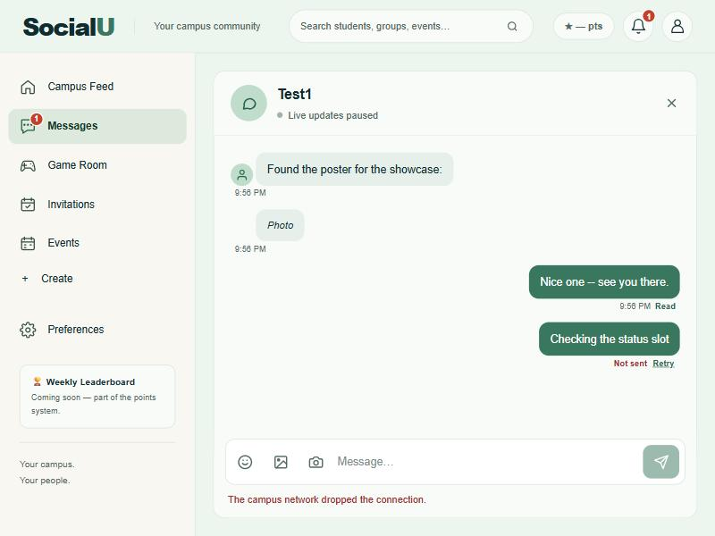

# SRS-211.5 — the failed status, from the UR-211 side

Owner: Loens Paul / bosspml.
Requirement: SRS-211.5 ([#1369](https://github.com/SonjaSeferasi/ssu-starter-app-v2/issues/1369)).
Branch: `srs-211.5-display-failed-status`.
No migration — this is entirely client-side.

## Why this item exists at all

The SRS states the same behaviour twice. SRS-201.16 asks for it under UR-201, *I want to send a
message*; SRS-211.5 asks for it under UR-211, *I want to know what happened to my message*. The
behaviour is one behaviour and #1368 built it.

Rather than fold this number into #1368 and leave it off the board, it carries its own card, its own
branch and its own tests — so the traceability table has a row for it, and so a later change to the
status slot cannot quietly break this requirement while SRS-201.16's own tests stay green.

## What it actually added

The card called this "deliberately small". Writing the tests made it slightly less small, because one
of the three properties could not honestly be asserted:

> a failed status and a read status are never shown at once

That rule lived in `app/messages/[conversationId]/page.tsx` as a ternary — `sendStatus ? … : readReceipt`.
It was correct, and it was unreachable: vitest runs here with `environment: 'node'` and there is no
React testing library, so a requirement written inside a component cannot be covered. The first draft
of the test dodged it by asserting something trivially true, which is worse than not testing it.

So the choosing moved into `lib/chat-message-status.ts`:

```ts
messageStatus(conversationKind, message, myStudentId)
  // { label: 'Sending…',  state: 'sending' }
  // { label: 'Not sent',  state: 'failed'  }
  // { label: 'Read',      state: 'read'    }
  // null
```

The page asks it and renders the one answer it gets. Nothing about the behaviour changed.

## The order is the point

What happened to the **send** is asked first, and only then whether the message has been **read**.

A message that has never reached the server cannot have been read, so the two should never compete —
but "should never" is not a thing to lean on when the cost of being wrong is telling a student their
message was read when it was never sent.

The test that matters makes the difference visible:

```ts
const message = { ...failed(), read: true };
expect(showsReadReceipt('private', message, ME)).toBe(true);          // on its own, it would say Read
expect(messageStatus('private', message, ME))                          // asked in order, it does not
  .toEqual({ label: 'Not sent', state: 'failed' });
```

`showsReadReceipt` genuinely returns `true` for that message — it is private, it is the student's own,
and it claims `read`. The only thing standing between a failed message and a wrong "Read" is the order
in which the two rules are asked, and that order now has a test on it rather than a ternary.

## Where SRS-211.5 differs from SRS-211.8

The read status is kept out of groups by SRS-211.9, because "has it been read" has no single answer
when several people could have read it. The failed status has no such limit: it is between the student
and the server, and has nothing to do with who else is in the conversation. `sendStatusLabel` is not
even given a conversation kind, and a test records that a failed group message is marked like any
other.

## Verified evidence

Taken November 18, 2026 against `scripts/tests/chat-evidence-fixture.mjs` — the real Next UI and the
real API routes over the real migrations in a disposable in-memory PGlite database. Only Supabase's
Auth and PostgREST transport is replaced. **The hosted database is never contacted.** The failure is
produced by replacing `window.fetch` so the send answers `502`.



Two of the student's own messages, one of each kind, in one conversation:

```
You: Nice one -- see you there.   9:56 PM  Read
You: Checking the status slot              Not sent  Retry
```

One status each, in the same slot, never both — the same screen the refactor was meant to leave
unchanged, confirmed unchanged.

## Tests

`__tests__/chat-failed-status.test.ts` — 12 tests, grouped by the three properties UR-211 cares about:

**The sender is told** — a failed message of their own shows `Not sent`; it does so in a group as well
as a private conversation; and a message still on its way says `Sending…` rather than claiming to have
failed.

**Nobody else is** — a received message shows nothing, including one that arrives claiming a `status`;
and the student's own saved message shows nothing, because it did not fail.

**One slot, one status** — the precedence above, including the `read: true` case; a saved message of
their own that has been read shows `Read`; `Sending…` wins over everything while a message is in
flight; nothing is shown on a received message, on a saved one nobody has read, or in a group
(SRS-211.9); and a conversation holding one of each gives exactly one answer per message.

110 tests green across the nine pure chat suites. `npx tsc --noEmit` reports nothing in any file this
branch touches.
