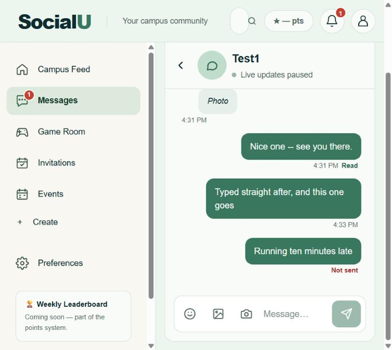

# SRS-201.17 — keep what failed, where it can be sent again

Owner: Loens Paul / bosspml.
Requirement: SRS-201.17 ([#1370](https://github.com/SonjaSeferasi/ssu-starter-app-v2/issues/1370)).
Branch: `srs-201.17-retain-failed-message-content`.
Builds on SRS-201.16 ([#1368](https://github.com/SonjaSeferasi/ssu-starter-app-v2/issues/1368)).
No migration — this is entirely client-side.

## Explanation for class

"Before #1368, a failed send left the typed text sitting in the message box, and that looked like
retention. It was retention in the wrong place. The box is also where the *next* message is typed, so
the failed content lasted exactly as long as it took the student to type anything else — and nothing
warned them that typing was about to throw it away."

#1368 put the failed message into the conversation. This item makes that message the **one** place the
content lives: the box is cleared the moment the message moves into the conversation, whether the send
goes on to succeed or fail, and `retainedContent` reads back off the message everything a send would
need.

## When the box is cleared, and why that exact moment

`deliver` now takes an `onQueued` callback and runs it as soon as the pending message is in the list.

- **Clearing on success**, which is what the page did before, would leave the text in the box *and* on
  the failed bubble at the same time — two copies of one message, one of which the student can destroy
  by typing.
- **Clearing before the send starts** would empty the box even when the double-send guard refused to
  send anything at all.

The reply bar follows the same moment, for the same reason: `reply_to_id` is on the message now.

## What is retained

```ts
retainedContent(message) // { text } | { text, kind: 'emoji' } | { text, replyToId }
```

The text or the emoji, and the message it was answering. A retry that had lost its reply target would
quietly send an ordinary message instead, which is not the message the student wrote.

It is read **only** off a local message. A message the server has saved needs no retry and its text is
the server's rather than a draft; returning content for one would invite a "retry" that sent a second
copy of something already sent.

## Surviving

A failed message has to still be there later, so `mergeMessages` moved out of
`app/messages/[conversationId]/page.tsx` into `lib/chat-messages.ts`. Nothing in it changed. It had
always lived in the page, where no test could reach it, and the rule SRS-201.17 depends on is a
property of exactly that function: **a message already on screen is kept unless the incoming list names
it**, and the server can never name a failed message, because the server has never heard of it.

That rule now has seven tests of its own, including the two ways a failed message could have been lost:
the history being loaded again, and somebody else's message arriving.

## Photos are out of scope

The SRS says "text, emoji, or GIF-library message" and names no photo. A chosen file cannot be held the
same way — it is a `File` the student picked, not text — so a failed photo keeps the behaviour
#1024 gave it: the chosen photo stays selected and Send tries again.

## The gap this opens, until #1371

With the box cleared and no **Retry** control yet, a failed message cannot be sent again except by
retyping it. The content is retained and visible on the bubble, but nothing acts on it.

That control is SRS-201.18 ([#1371](https://github.com/SonjaSeferasi/ssu-starter-app-v2/issues/1371)),
the next branch. **This one is better merged with it, or just before it**, rather than left on `main`
on its own — recorded here rather than discovered later.

## Verified evidence

Taken November 18, 2026 against `scripts/tests/chat-evidence-fixture.mjs` — the real Next UI and the
real API routes over the real migrations in a disposable in-memory PGlite database. Only Supabase's
Auth and PostgREST transport is replaced. **The hosted database is never contacted.** The failure is
produced by replacing `window.fetch` so that the send answers `502`; everything else is real.



In order: `Running ten minutes late` was sent and refused. The message box was then **empty** — on the
build before this branch it still held that text. The student typed and sent
`Typed straight after, and this one goes`, which succeeded and carries `4:33 PM`. The failed message is
still there, still reading **Not sent**, still at the bottom where unsent messages sit, with its text
intact.

Read out of the page in that state:

```
You: Nice one -- see you there.               4:31 PM  Read
You: Typed straight after, and this one goes  4:33 PM
You: Running ten minutes late                 Not sent
composer: ""
```

## Tests

`__tests__/chat-messages.test.ts` — 7 tests, new file for the moved function: a failed message survives
the history being loaded again, survives another message arriving and stays at the bottom, and keeps
what it was answering; an incoming message still replaces the one on screen; a message that arrives
from both the send and the live event is not duplicated; and SRS-201.7's photo-link rule still holds in
both directions.

`__tests__/chat-send-status.test.ts` — 6 added for `retainedContent` (22 in the file): the text, the
emoji kind, the reply target, that it reads the same while sending and after failing, that a saved
message gives nothing back even if it claims a status, and that an empty message gives nothing back.

29 tests green across the two files; `npx tsc --noEmit` reports nothing in any file this branch touches.
