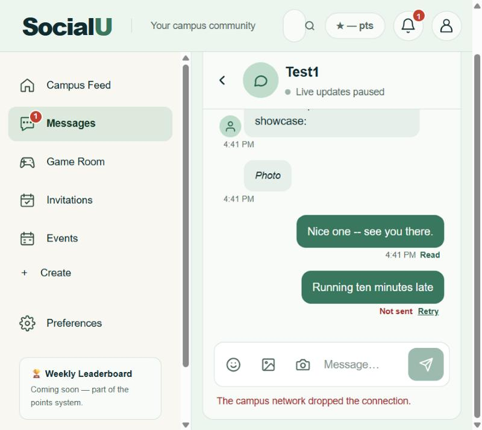
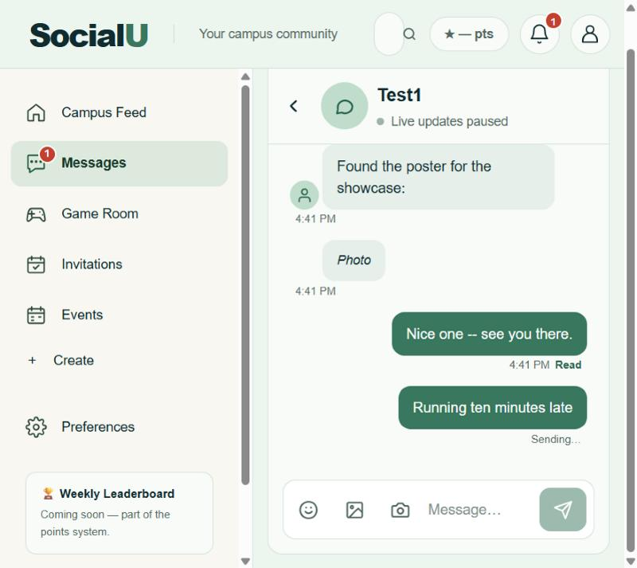
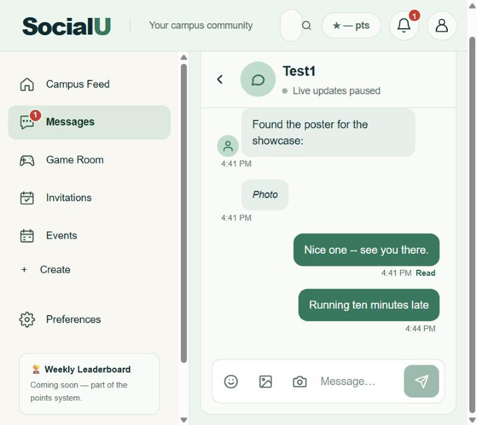

# SRS-201.18 — send a failed message again, without writing it again

Owner: Loens Paul / bosspml.
Requirement: SRS-201.18 ([#1371](https://github.com/SonjaSeferasi/ssu-starter-app-v2/issues/1371)).
Branch: `srs-201.18-retry-a-failed-message`.
Builds on SRS-201.16 ([#1368](https://github.com/SonjaSeferasi/ssu-starter-app-v2/issues/1368)) and
SRS-201.17 ([#1370](https://github.com/SonjaSeferasi/ssu-starter-app-v2/issues/1370)).
No migration — this is entirely client-side.

## Explanation for class

"#1368 showed the failed message. #1370 made it carry its own content. Neither of them gave the
student anything to press. Retrying still meant typing the message out again, which is exactly what
SRS-201.18 says must not be necessary — *retry sending a failed message **without recreating the
message***."

**Retry** now sits beside **Not sent**, on the message.

## Everything it sends comes off the message

```ts
sendBody(retainedContent(message))
```

Not from the message box, not from the reply bar. The student has moved on from both by now — #1370
cleared them — and may well have typed something else into them since. The text or the emoji, and the
message it was answering, all come from the failed message itself.

An emoji goes back **as an emoji**. Sent as text it would arrive as a text message that happens to
contain an emoji, which SRS-201.9 renders differently, and that is not what was written.

## It cannot make a second message

This is the one thing a retry must never do, and three things stop it:

**The same local id.** A retry is the same call on the same local message, not a new one, so it keeps
its place in the conversation rather than adding a copy below it. `sendLocalMessage` is shared by the
first send and every retry for exactly this reason.

**The control is gone while it is in flight.** It renders only when `hasFailedToSend` is true, and a
retry sets the message back to `sending` before the request leaves.

**A ref closes the gap before React re-renders.** A second click can land in the moment between the
click and the button disappearing. `retryingRef` holds the ids being retried and refuses a second
attempt, the same pattern `sendingRef` uses for the message box and `reactingRef` for reactions.

Once the server answers, the local message is dropped and the saved one takes its place — so a message
that has succeeded has no Retry control because it is no longer a local message at all.

## If the retry fails too

It goes back to **Not sent** and can be retried again, as many times as the student likes. Each
attempt clears the error line first, so what is shown under the message box is about the attempt just
made rather than the one before it.

## The control

Visible, not revealed on hover. The reaction and reply buttons appear on hover because people go
looking for them; this is the only way back from a failed send, and a control nobody finds is a control
that is not there — the same reasoning recorded at the photo delete in #1106.

Underlined green, matching the history's own *Try again*, so the control that undoes a failure looks
the same wherever it appears. 6.8:1 on the panel.

Every Retry button says "Retry", so the accessible name says which message:
`Send “Running ten minutes late” again`, cut short at 40 characters for a long one. A screen reader is
not offered a row of identical buttons.

## Verified evidence

Taken November 18, 2026 against `scripts/tests/chat-evidence-fixture.mjs` — the real Next UI and the
real API routes over the real migrations in a disposable in-memory PGlite database. Only Supabase's
Auth and PostgREST transport is replaced. **The hosted database is never contacted.** The failure is
produced by replacing `window.fetch` so the send answers `502`; the patch is then switched off so the
same button can succeed. Everything else is real.

### 1. Retry, on the message



`Not sent  Retry`. Read off the page, the button's accessible name is
`Send “Running ten minutes late” again`.

### 2. While it is on its way



The same message, same place, now reading **Sending…** — and the Retry button is gone, so it cannot be
pressed twice. The error line under the message box has cleared too.

This attempt was also made to fail; it went back to **Not sent** with its Retry control, and was
retried a second time.

### 3. The second retry succeeded



It is an ordinary message now: `4:44 PM`, a React button, no Retry, still in the place it occupied
while it was failing.

### One copy, checked in the database

After a failed send, a failed retry and a successful retry, the conversation read back from the API:

```
id 1  Test1  Found the poster for the showcase:
id 3  Test1  (photo)
id 4  Loens  Nice one -- see you there.
id 9  Loens  Running ten minutes late
copies of the retried message: 1
```

## Tests

`__tests__/chat-send-status.test.ts` — 8 added (30 in the file): a text message goes back as its text,
an emoji as an emoji, a reply as a reply to the same message; `markSending` puts it back on its way
keeping its id and its place, and it can fail and be retried again; marking touches only the message
being retried; the accessible name names the message, cuts a long one short, and falls back to plain
`Retry` when there is nothing to send.

37 tests green across `chat-send-status` and `chat-messages`; `npx tsc --noEmit` reports nothing in any
file this branch touches.
