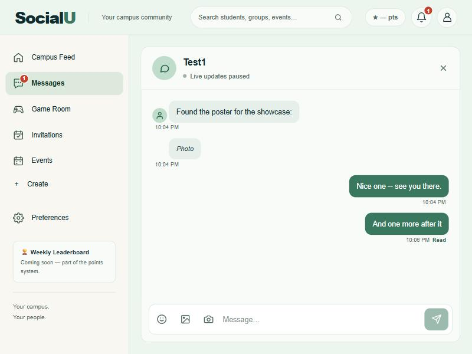

# SRS-211.4 — tell the sender their message was sent

Owner: Loens Paul / bosspml.
Requirement: SRS-211.4 ([#1372](https://github.com/SonjaSeferasi/ssu-starter-app-v2/issues/1372)).
Branch: `srs-211.4-display-sent-status`.
Builds on SRS-211.5 ([#1369](https://github.com/SonjaSeferasi/ssu-starter-app-v2/issues/1369)), which
made the status slot a rule instead of a ternary.
No migration — this is entirely client-side.

## Explanation for class

"Nothing was shown. #1283 left this silent on purpose and said so in its own write-up: putting 'Sent'
there would have been this requirement, which was not built, and silence was the honest state until it
was. It is now."

`Sent` completes the slot. A message of the student's own that the server has saved says **Sent**,
until the other student reads it and it says **Read** instead.

## LP's decision: the latest message only

The SRS says "a sent status for that message", and the most literal reading would put a label under
every bubble on the student's side of the conversation. That was put to LP as a choice, and the answer
was **only on their most recent message**.

The reasoning is worth keeping: a column of labels down one side is noise, and the question people
actually ask — *did the last thing I said get through* — is about the last thing they said. iMessage
does the same.

It applies to **Read** as well, which is a change to #1283's behaviour: a read receipt no longer stays
on every message the other student has read, only on the latest one. That was part of the same
decision.

It does **not** apply to the send statuses. A message that failed says **Not sent** wherever it sits,
and several can be sitting failed at once — each one needs its own answer, because each one is a
separate thing the student may want to retry.

## Two questions, two places

```ts
showsSentStatus(message, myStudentId, isSaved)   // about the message: is it mine, does the server have it
latestOwnMessageId(messages, myStudentId)        // about the conversation: which of mine is the last
messageStatus(kind, message, myStudentId, isLatestOwn)  // puts them together with Read and the send statuses
```

`latestOwnMessageId` looks for the last **saved** message of the student's own, skipping anything that
has not been sent. A failed message at the bottom of the conversation must not take the status off the
last message that actually reached the server: the failed one says `Not sent` for itself, and the one
above goes on reporting what happened to it.

## Where SRS-211.4 differs from SRS-211.8

SRS-211.9 keeps the **read** status out of group conversations, because "has it been read" has no
single answer when several people could have read it.

"Was it sent" has exactly one answer everywhere, so the **sent** status is shown in a group too. In a
group it is the only status the slot will ever show, which is correct rather than a gap.

## The order inside the slot

1. `Sending…` / `Not sent` — what happened to the send, asked first and not limited to the latest message
2. `Read` — once the other student has read it
3. `Sent` — once the server has it

Read before Sent: once a message has been read it has plainly been sent, and the later state is the one
worth the slot.

## Colour

`Sent` is `#536963` bold — the time's own grey rather than the read status's green. Being sent is the
ordinary outcome and should not announce itself the way being read does, but it has to be legible as a
word and not read as part of the time beside it. 5.9:1 on white, 5.6:1 on the panel; AA either way.

## Verified evidence

Taken November 18, 2026 against `scripts/tests/chat-evidence-fixture.mjs` — the real Next UI and the
real API routes over the real migrations in a disposable in-memory PGlite database. Only Supabase's
Auth and PostgREST transport is replaced. **The hosted database is never contacted.**

### 1. Sent, on the latest message only


```
You: Nice one -- see you there.   10:04 PM
You: And one more after it        10:06 PM  Sent
```

The newly sent message carries `Sent`. `Nice one -- see you there.` above it carries only its time —
it had a `Read` before this change, and losing it is the decision above, working.

### 2. Sent gives way to Read



Test1 then marked the conversation read. The same message, the same slot:

```
You: And one more after it        10:06 PM  Read
```

One slot, one status, and the later state wins.

## Tests

`__tests__/chat-sent-status.test.ts` — 12 tests in three groups.

**Whether a message can say it was sent** — the student's own saved message can; a received message
never can, because telling a reader that the message they are reading was sent tells them something
they can see; a message the server does not have never can, because the send status speaks for it; and
nothing is claimed before the student's own id is known.

**Which message is the latest of the student's own** — the last one *they* sent rather than the last
in the conversation; skipping anything unsent; and nothing when they have said nothing or their id is
unknown.

**The status each message ends up showing** — `Sent` on the latest and nothing on the ones before it;
`Read` taking over once it has been read; `Sent` shown in a group where `Read` is not; the send status
winning and not being limited to the latest message; and nothing at all on a received message.

`__tests__/chat-failed-status.test.ts` gained one case and two were rewritten, because limiting `Sent`
and `Read` to the latest message changed what `messageStatus` answers for messages before it. The
changes are in the diff rather than hidden behind a default argument — `isLatestOwn` is required, so
every call site had to be looked at.

123 tests green across the ten pure chat suites. `npx tsc --noEmit` reports nothing in any file this
branch touches.
