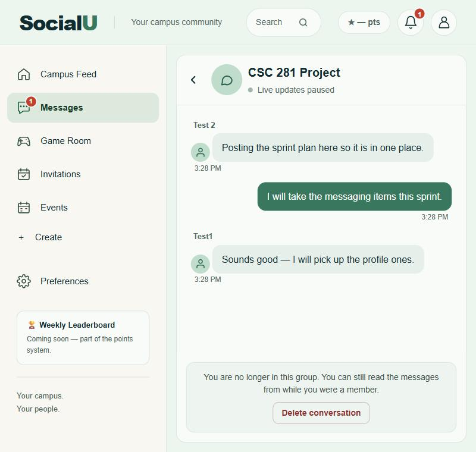
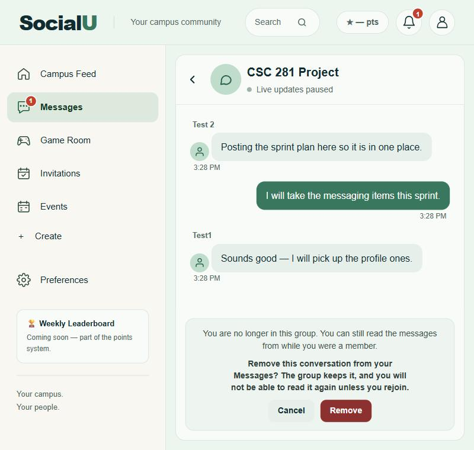
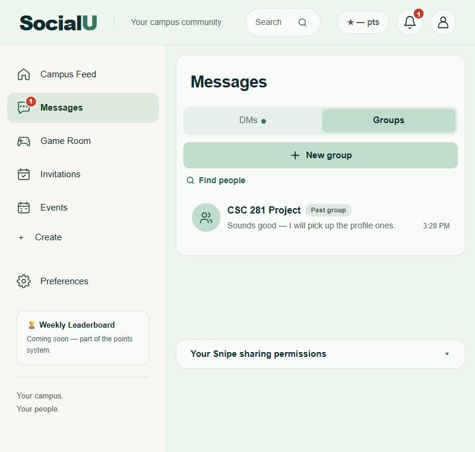
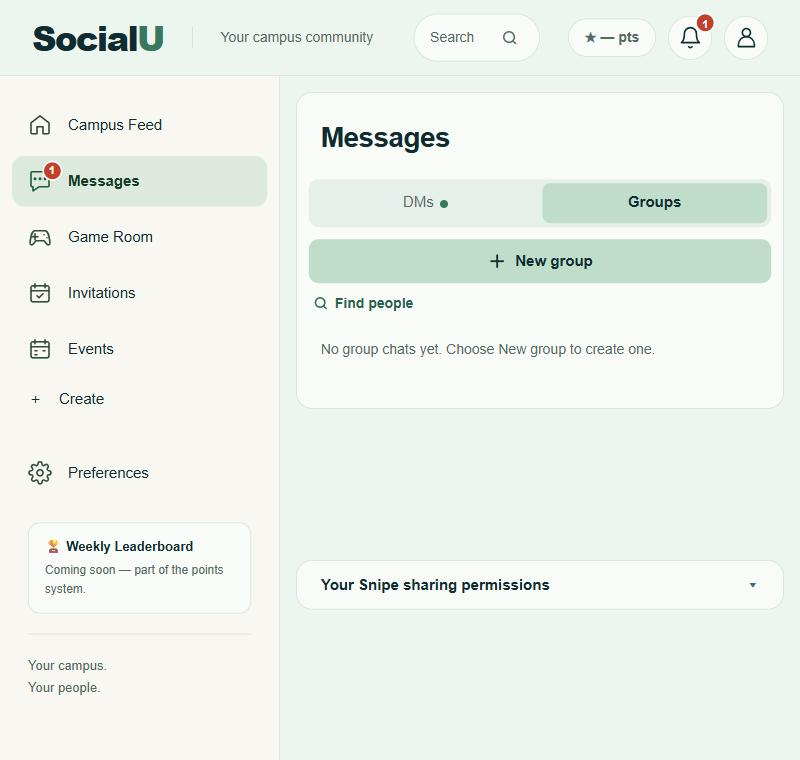
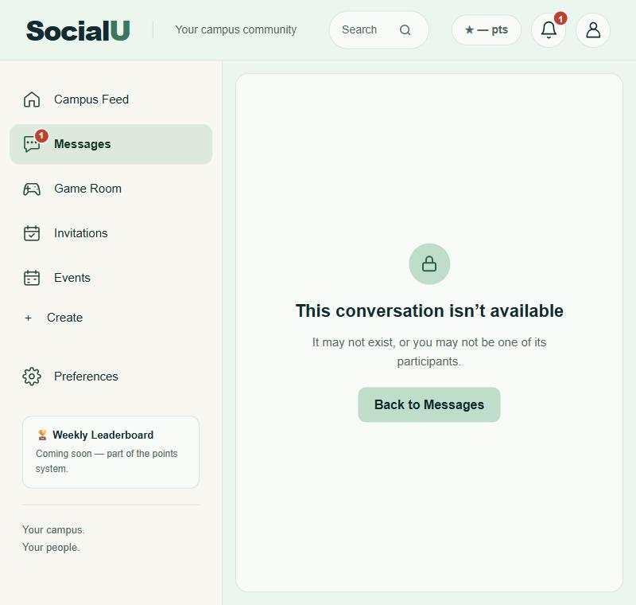
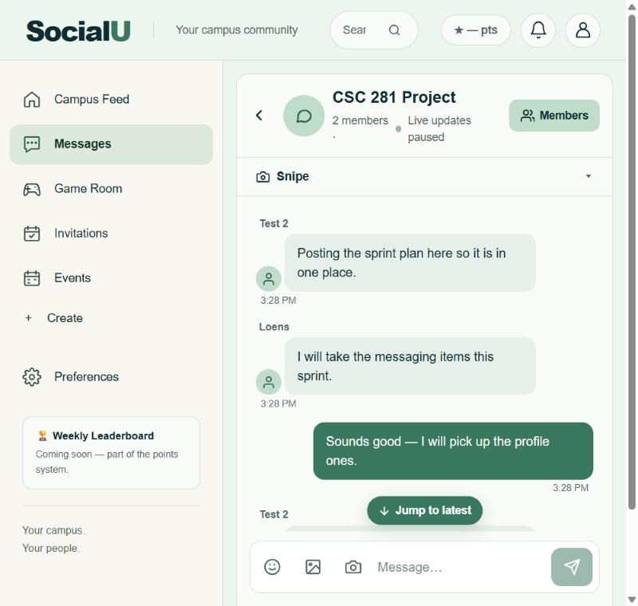

# SRS-207.7 / SRS-207.6 — a former group member can delete the conversation from their view

Owner: Loens Paul / bosspml.
Requirement: SRS-207.7 ([#888](https://github.com/SonjaSeferasi/ssu-starter-app-v2/issues/888), the
removal itself) and SRS-207.6
([#1264](https://github.com/SonjaSeferasi/ssu-starter-app-v2/issues/1264), the control that calls it).
Branches: `srs-207.7-delete-former-group-conversation`, merged in
[#1265](https://github.com/SonjaSeferasi/ssu-starter-app-v2/pull/1265); and
`srs-207.6-offer-conversation-deletion`, merged in
[#1277](https://github.com/SonjaSeferasi/ssu-starter-app-v2/pull/1277).
Migration: `20261117020000_chat_delete_former_group_conversation.sql` (SHA-256 `e03447f…`).

## Explanation for class

"SRS-207.7 was parked back in November, and the reason given was fair at the time: leaving a group
already made the conversation vanish from your list, so there was nothing left for a delete button to
do. #1222 changed that. A former member now keeps the conversation, marked `Past group`, and can read
their own history. The moment that became true, 'delete it from my view' became a real requirement
again — some people will want to keep that history and some will want it gone, and that is their
call, not ours."

`hidden_conversations` has been in `schema.sql` since the start of the project, unused, carrying LP's
own note *Supports: SRS-207.6, SRS-207.7*. This is the table it was shaped for.

## The two decisions behind it

**Deleting means deleting everywhere, not only the list.** A former member who deletes the
conversation is also refused if they open it by a direct link. A bookmark must not resurrect what
someone chose to delete. The same gate goes on `socialu_conversation_messages` and
`socialu_mark_conversation_read`, not just on the list.

**Nothing changes for anyone still in the group.** The deletion is one row for one student. The group
keeps the conversation and every other member sees it untouched.

The one new column is `hidden_at`. Without it, a student who deleted a group, was invited back, and
later left again would find it already gone without ever asking. Comparing the deletion against the
newest membership's `joined_at` makes the row expire on rejoining, so the join path needs no cleanup.

```
socialu.conversation_hidden   helper, mirroring was_participant
socialu_delete_conversation   SC404 never a participant, or already deleted
                              SCH01 not a group
                              SCH02 still a member
conversation_list             a deleted conversation is left out
conversation_messages         and refused
mark_conversation_read        and refused
```

## The wording

> Remove this conversation from your Messages? The group keeps it, and you will not be able to read it
> again unless you rejoin.

A button called "delete" in a group chat invites exactly one wrong assumption — that it deletes for
everyone — and that has to be answered *before* it is acted on, not after. The warning also says what
is lost. It never says "permanently" or "cannot be undone", because neither is true: rejoining brings
it back.

The warning is in the page rather than `window.confirm`, for the reason recorded at the photo delete
in #1106 — a browser that has had dialogs suppressed returns false without showing anything, which
reads as "no" and silently does nothing.

`canDeleteConversation` is the same condition as `isReadOnly`, named separately so the page reads the
way SRS-207.6 does, and so changing one does not silently change the other. Both live in
`lib/chat-former-member.ts` with the wording, because vitest runs here with `environment: 'node'` and
no React testing library.

Contrast on the notice background: the control 7.3:1, **Remove** 6.5:1, **Cancel** 12.6:1 — all AA.

## Verified evidence

Taken November 18, 2026 against `scripts/tests/chat-evidence-fixture.mjs` — the real Next UI and the
real API routes over the real migrations in a disposable in-memory PGlite database. Only Supabase's
Auth and PostgREST transport is replaced. **The hosted database is never contacted.**

Three students are seeded under the names of the accounts this project is tested with: **Loens**,
**Test1** and **Test 2**. They are local rows in the fixture's own database, not the hosted accounts.
Test 2 owns **CSC 281 Project** with Loens and Test1, then **removes** Loens and sends one more
message afterwards. Loens is the signed-in student throughout except where noted.

The *before* state for this item is the state #1222 left behind, already recorded as
`1222-evidence/04-after-history-read-only.jpg`: a read-only conversation with a notice and no way to
get rid of it.

### 1. The control, where the student can see what they would be giving up



The control sits inside the read-only notice, under the sentence explaining why the conversation is
read-only. The Messages-list row cannot show them that context; this is the one place that can.

### 2. The warning answers the wrong assumption first



### 3. Cancel leaves it exactly as it was



`CSC 281 Project` with its `Past group` badge, still listed, preview unchanged.

### 4. Remove takes it out of the list



`No group chats yet. Choose New group to create one.` The page returns to Messages on success.

### 5. A direct link afterwards is refused too



Opening `/messages/3` by hand after the deletion answers *This conversation isn't available.* — the
same answer a stranger gets. This is the decision above, working: the gate is on the history and the
read-marking, not only on the list.

### 6. Nothing changed for a current member



Test1, still a member, opens the same conversation: `2 members`, the Members button, every message
including the one Test 2 sent after Loens was removed, and a working composer.

### A note on "Live updates paused"

The fixture replaces Supabase's transport and serves no Realtime socket, so the page correctly
reports that live updates are not running. Everything shown above is a server response, not a live
event.

## Tests

- `__tests__/database/delete-former-conversation.test.ts` — 8 scenarios over the migration in PGlite:
  the deletion, the three refusals (`SC404`, `SCH01`, `SCH02`), the list exclusion, the history
  refusal, the read-marking refusal, and that rejoining brings the conversation back. The rejoin case
  asserts that a message sent while the student was away stays unreadable afterwards — two messages,
  not four.
- `__tests__/api/conversation-delete.test.ts` — 7 cases over the `DELETE` route and its error mapping.
- `__tests__/chat-former-member.test.ts` — 18 in the file, 10 of them added for SRS-207.6: when the
  control appears, and that the wording never promises permanence.

Every existing chat suite re-checks the three replaced functions.

## Reproducing the evidence

```
node scripts/tests/chat-evidence-fixture.mjs
```

The group is conversation `3`; student 1 is the removed member and student 2 is still in it. The
fixture prints a sign-in token for each student.

## Hosted migration

`20261117020000` was applied to the hosted project and recorded: read-only probe, SHA-256 of the
editor content checked against the committed file (`e03447f…`), a dry run inside a rolled-back
transaction, the rollback verified clean, then applied and verified — the helper present, all three
gates in place, Linh's `socialu.community_unavailable` rewrite repeated for `socialu_conversation_list`
(the only one of the three that calls `socialu.is_blocked`), and nothing granted to `anon` or
`authenticated`.

The file was originally numbered `20261116230000`. It was renamed before being applied, because that
version would have sorted *before* two migrations already recorded in the hosted project. Contents
unchanged.
