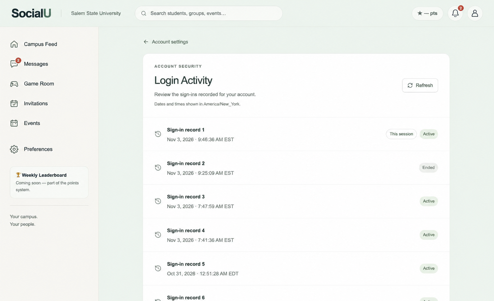
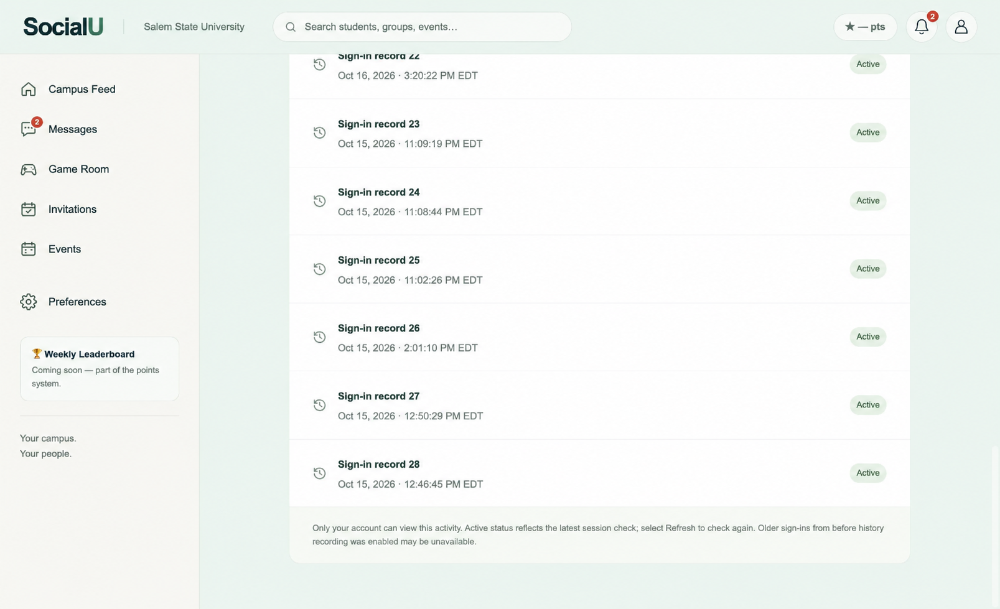

# Linh Nguyen - Sprint 3 closeout

Status checked November 4, 2026. Owner: Linh Nguyen (LN), Dieulinhh23.

This package follows the professor's two-level SRS/task structure and separates completed vertical slices from unfinished acceptance. It does not backdate board history or claim a grade.

## Submission files

- [Updated submission PDF](Linh_Nguyen_Sprint_3_Updated.pdf): current three-page version including My Board progress; black text, color screenshots.
- [My Board acceptance record](My_Board_Acceptance.md): confirmed student evidence, tests and remaining checks.
- [Ready-to-paste #1038 issue update](Issue_1038_Update.txt): prepared body; not applied because GitHub denied editing.

- [Basic submission PDF](Linh_Nguyen_Sprint_3_Basic.pdf): preferred two-page submission, black text and color screenshots with mouse pointers removed.
- [Detailed submission PDF](Linh_Nguyen_Sprint_3_Submission.pdf): earlier four-page version, retained for reference.
- [Canvas text](Canvas_Submission.txt): copy-ready project, SRS and merged PR links.
- [Board updates](Board_Updates.txt): exact remaining changes; NOT applied by this package.
- [Status manifest](status.json): verified issue/PR checkpoint.

## Completed vertical slices

| Exact SRS title | Issue | Merged PR | Actual SRS branch |
| --- | --- | --- | --- |
| SRS-107.1, LN — Login-history access. | [#858](https://github.com/SonjaSeferasi/ssu-starter-app-v2/issues/858) | [#963](https://github.com/SonjaSeferasi/ssu-starter-app-v2/pull/963) | `linh/srs-107.1-login-history-access` |
| SRS-107.2, LN — Complete login history. | [#859](https://github.com/SonjaSeferasi/ssu-starter-app-v2/issues/859) | [#964](https://github.com/SonjaSeferasi/ssu-starter-app-v2/pull/964) | `linh/srs-107.2-complete-login-history` |
| SRS-107.3, LN — Login date. | [#860](https://github.com/SonjaSeferasi/ssu-starter-app-v2/issues/860) | [#965](https://github.com/SonjaSeferasi/ssu-starter-app-v2/pull/965) | `linh/srs-107.3-login-date` |
| SRS-107.4, LN — Login time. | [#861](https://github.com/SonjaSeferasi/ssu-starter-app-v2/issues/861) | [#966](https://github.com/SonjaSeferasi/ssu-starter-app-v2/pull/966) | `linh/srs-107.4-login-time` |
| SRS-107.6, LN — Active-session status. | [#879](https://github.com/SonjaSeferasi/ssu-starter-app-v2/issues/879) | [#967](https://github.com/SonjaSeferasi/ssu-starter-app-v2/pull/967) | `linh/srs-107.6-active-session-status` |

All five parents and 20 child tasks were verified closed and assigned to Dieulinhh23. Each SRS issue has the shall statement, acceptance criterion, UR trace, branch/PR and screenshot.

## Additional implemented work

[My Board #1038](https://github.com/SonjaSeferasi/ssu-starter-app-v2/issues/1038) has merged [PR #1043](https://github.com/SonjaSeferasi/ssu-starter-app-v2/pull/1043) and genuine save/reload evidence. Linh subsequently supplied and confirmed resized-item save/refresh and a classmate-account view. Their recent image files still need attaching to #1038. Changed-rotation reload and blocked access remain unverified; the issue remains open. Linh reported team acceptance of the SRS addition. Prototype coding before SRS registration is retained as a process finding.

[Saved-board evidence](my-board-save-reload-evidence.png) is the original existing capture from Linh's own account. It is not separate-student evidence or a new verification run.

## Deferred / incomplete

Linh deferred further location work at sprint closeout. #878 and #880-#882 lack complete live acceptance. PRs #1068, #1072 and #1073 are merged; #1071 remains open. Keep unfinished issues open and return remaining acceptance to Product Backlog for Sprint 4. Existing implementation is preserved.

## Verification and evidence

- Main checkpoint on November 3: 1,371 tests in 159 files and production build passed. Historical result, not a new full-suite run.
- November 4 device branch: 32 relevant tests and production build passed; login/context/database run passed 51 tests.
- Real Login Activity screenshots: [15532cf](https://github.com/SonjaSeferasi/ssu-starter-app-v2/tree/15532cf/documentation/sprint3/implementation).
- My Board image: previously published fresh-load capture from 340be33, already attached to #1038.
- No fabricated location or screenshots. No passwords, tokens, IP addresses or new location screenshots are included.

## GitHub synchronization limit

The issue-update connector returned HTTP 403. Browser inventory worked, but claim/navigation failed before editing. No issue-body or project-status updates are claimed. Apply [Board_Updates.txt](Board_Updates.txt) to reconcile the live board.

## Demo and Canvas

Use one laptop and one integrated checked-in codebase. Show the five completed Login Activity behaviors, tasks and merged PRs. Disclose unfinished work. Submit the links from Canvas_Submission.txt and attend the sprint demo.

## Screenshot presentation copies

These presentation copies remove only mouse pointers and their highlight for readability. They were cosmetically edited with an image tool. Original captures remain available below; this cleanup is not a new acceptance test.

### Login Activity and session status

[Original unedited capture](https://raw.githubusercontent.com/SonjaSeferasi/ssu-starter-app-v2/15532cf/documentation/sprint3/implementation/login-activity-ended-nov3.png)

### Older login-history records

[Original unedited capture](https://raw.githubusercontent.com/SonjaSeferasi/ssu-starter-app-v2/15532cf/documentation/sprint3/implementation/login-activity-older-nov3.png)
