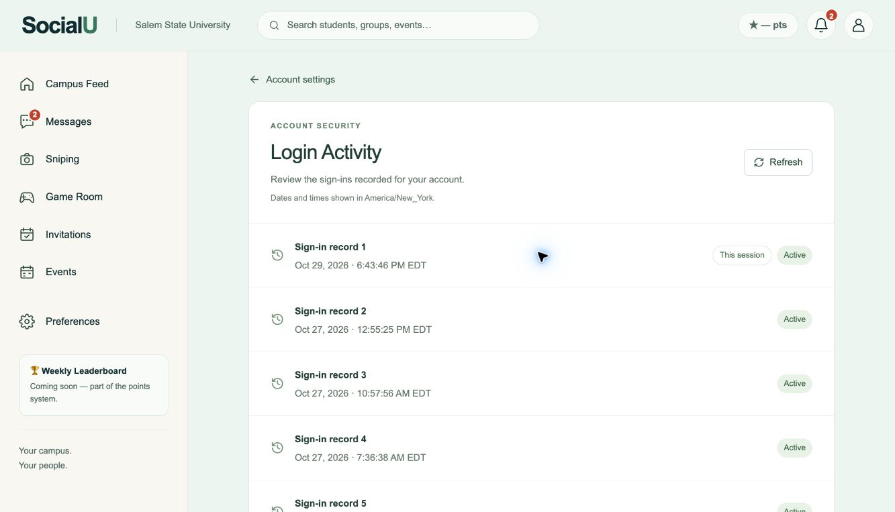
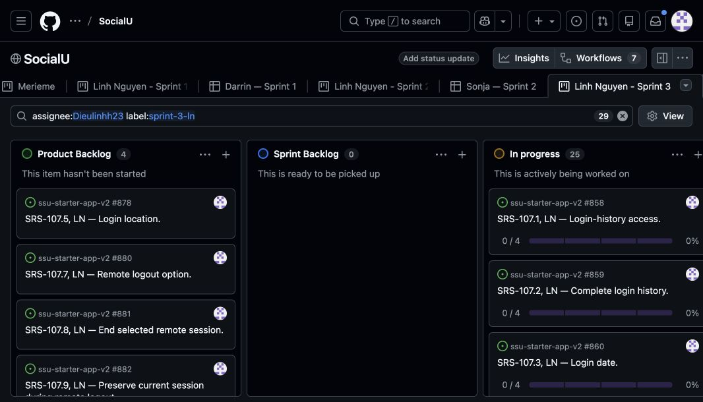

# Sprint 3 implementation — Linh Nguyen — October 29, 2026

> **Latest integration check:** main’s newer event work is included in the final feature branch. All 1,072 tests in 126 files and the integrated production build pass. PR merges and board completion remain pending because GitHub writes and browser control are unavailable. See [merge-readiness.md](merge-readiness.md).

The five selected Login Activity items have implementation commits on their own pre-created SRS branches. All five PRs target main and remain **drafts awaiting review and merge**. This is implementation/evidence progress, not a declaration that the sprint, attendance or Canvas submission is complete.

| SRS / parent | Implementation PR | Branch | Focused commit |
| --- | --- | --- | --- |
| 107.1 / #858 | [#963](https://github.com/SonjaSeferasi/ssu-starter-app-v2/pull/963) | linh/srs-107.1-login-history-access | 80fbfcc |
| 107.2 / #859 | [#964](https://github.com/SonjaSeferasi/ssu-starter-app-v2/pull/964) | linh/srs-107.2-complete-login-history | 409c40b |
| 107.3 / #860 | [#965](https://github.com/SonjaSeferasi/ssu-starter-app-v2/pull/965) | linh/srs-107.3-login-date | ec06040 |
| 107.4 / #861 | [#966](https://github.com/SonjaSeferasi/ssu-starter-app-v2/pull/966) | linh/srs-107.4-login-time | c27d1da |
| 107.6 / #879 | [#967](https://github.com/SonjaSeferasi/ssu-starter-app-v2/pull/967) | linh/srs-107.6-active-session-status | 33ba8f0 |

Merge in that order so each later PR's dependency commits are already integrated. No PR has been merged by this record. Initial branches were created October 27–28 before coding; the first branch was fast-forwarded to integrated main `e4f43af` before the first implementation commit. The original working checkout and its three local-only unfriend files were left unchanged. The isolated implementation checkout is `/private/tmp/socialu-sprint3-implementation`.

## Behavior

Account Settings → Login Activity opens `/account/login-activity`. Its API uses the verified bearer identity, never a URL-supplied user. Records come from real provider-session creation timestamps. After a provider session is deleted, its history remains. A stable `(signed_in_at, history_id)` cursor reaches all older pages without offset limits. Dates and times share the browser timezone, including the daylight-saving abbreviation. Active status checks provider existence, persisted `not_after` expiry and the existing application's revocation cutoff/preserved-session rule. Only the current-session boolean is returned; provider session IDs, passwords and tokens are not exposed.

This adds a provider audit archive, `socialu.login_history`. The proposed `socialu.login_sessions` table models application-issued token digests and student IDs, but the current authentication implementation uses Supabase-owned sessions instead. The new archive can record provider sessions before student onboarding and survive provider-session deletion. It does not replace the provider's session manager, invent token digests, or change the existing revocation rules. Schema review of the older proposed table remains separate.

## Database deployment

With Linh's explicit approval, these migrations were applied atomically in the shared project's SQL editor on October 29:

1. `20261029100000_login_history.sql` — durable history, restricted read function, capture/backfill.
2. `20261029101000_complete_login_history.sql` — complete keyset pagination.
3. `20261029102000_login_activity_status.sql` — real active/current status and backward-compatible read signatures.

The result was `history_api_installed = true`; 150 existing provider sessions were imported at installation. Subsequent real sign-ins are recorded automatically. No sessions were ended, no friendships were changed, and no passwords or tokens were stored. Already-deleted sessions from before installation cannot be recovered. The archive stores sign-in/session history, not failed-password attempts, device identity or a location estimate. Auth policies that expire sessions should be rechecked if provider configuration changes.

## Verification

- `npx tsc --noEmit`: passed.
- `npm run build`: passed. The first sandbox attempt could not resolve existing Google Fonts; retry with network access passed.
- `npx vitest run --maxWorkers=2 --minWorkers=1`: **1,028 tests passed in 121 files**. See [validation.txt](validation.txt).
- Eleven focused cases cover verified-identity boundaries, storage failure, cursor validation, retained historical records, owner isolation, denied direct authenticated-role RPC access, inactive accounts, equal timestamp ordering, 62-entry pagination with a concurrent new record, provider expiry/deletion, application revocation/preserved current session, date boundaries, leap days and repeated daylight-saving hours.
- One new database test initially compared two equivalent timestamp strings with different offsets. It was corrected to compare the represented instant, and the full suite was rerun successfully.

Tests use mocked Supabase API calls and a disposable PGlite database with the real project schema/migrations. They do not modify hosted test accounts.

## Real running-app evidence

Linh signed in herself at `http://localhost:3002`. The agent used that same signed-in tab, followed Account Settings → Login Activity, and observed 20 recorded sign-ins with stored dates/times, active badges and one “This session” badge. Reload and Refresh each retained the same 20 entries. The date/time strings were rendered from the API's stored `datetime` values in `America/New_York`.

Linh explicitly approved publishing these screenshots as GitHub evidence. They contain sign-in timestamps and status but no credentials, IP addresses or location.

- [Running page, first records and current-session badge](login-activity-desktop.png).
- [Complete recorded history and end of list](login-activity-all-records.png).

The live account has fewer than 25 entries, so larger multi-page history is proven by the isolated database test, not by a fabricated live page. The live account showed active sessions; expiry/deletion/revocation behavior was verified in the isolated database. No other real device was signed out for this demonstration. The evidence shows the combined feature branch, not a merged main deployment.

## Remaining review and submission work

Review and merge the five implementation PRs in order, add closing references only for tasks whose full acceptance is satisfied, and update the board as that happens. Keep parents open until acceptance, evidence and the team's Definition of Done are met. The per-SRS evidence is linked from the GitHub cards. If the instructor requires a real multi-page or two-session ended-state demonstration, arrange authorized sessions and capture it separately; do not label isolated tests as that live demonstration. Demo attendance and Canvas submission remain Linh's responsibility.

## Board checkpoint

After implementation on October 29, the saved Sprint 3 view contains four future Product Backlog items and 25 In progress items (five selected parents plus 20 child tasks). None is marked Done. All five cards link the approved real screenshots and draft PRs.

