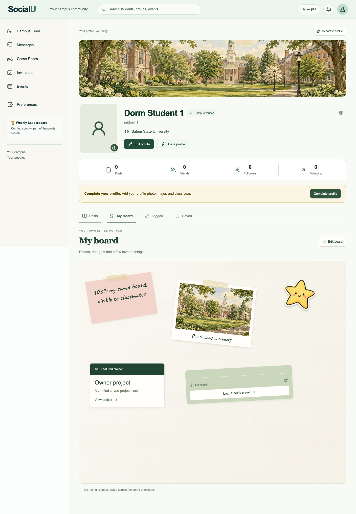

# Task #1039 — data contract and ownership acceptance

Parent SRS-124.1 #1038 → UR-124. Owner: Linh Nguyen / Dieulinhh23.
Branch `srs-124.1-task-1039-data-ownership-acceptance` was created before this acceptance work. The original implementation is already merged via PR #1043; this follow-up adds the missing reviewable acceptance evidence rather than inventing a production-code change.

## Status

Local acceptance passed. Hosted acceptance has **not run**: automatic approval review rejected a proposed service-role test that would create accounts and modify hosted Auth/database/storage because the user had not explicitly approved that operation and cleanup could not be guaranteed. Task #1039 remains open and this PR remains draft until the hosted test is approved/performed and results reviewed. No hosted accounts or data were changed by the rejected operation.

## Completed local verification

The actual Next production UI/API and repository SQL run with disposable PGlite and fixture Auth/PostgREST/media signing. Two independent browser contexts represent owner A and visitor B.

- Save a valid five-card board with unique IDs, bounded content, fractional positions, sizes and rotations. An exact PostgreSQL save/read matches the board; unrelated hometown/look data survives.
- Reload the owner profile and render the saved content with owner controls.
- Visitor B reads the exact saved values and rendered owner photo; no Edit board or Save board controls appear.
- A forged PATCH naming A still saves only authenticated B's own board; A's stored board remains unchanged. An explicitly targeted foreign SQL save is rejected with `42501`.
- Blocking B makes the owner-space read return 404 and removes the profile board from B's page. A still reads its unchanged board.
- 53 focused tests pass across board validation, API, PostgreSQL ownership, atomic persistence and photo ownership.

[Executed local trace](1039-evidence/contract-ownership-trace.json). These screenshots use an existing public artwork image and simulated auth transport; they are not hosted-account acceptance.

## Concrete hosted test awaiting approval

`scripts/tests/board-contract-ownership.live.cjs` is opt-in only and verifies the project hostname is `sfrpokisjlwgknxlzllu.supabase.co`. It creates two random private `qa1039_*` accounts, signs in both, uploads one public test PNG into the owner's folder, and runs the same save/read/visitor/forged-owner/block checks through a configured local production app connected to real Supabase Auth, PostgreSQL and private storage. Existing students are never targets.

Cleanup independently attempts to clear both QA boards, remove the QA-only pinned photo and verified storage object, deactivate both QA accounts and revoke their app sessions. Each cleanup stage is recorded even if another fails. Provider/network failures can prevent complete cleanup; deactivated synthetic audit/account records can remain. Credentials and tokens are never written to the evidence trace.

Only after explicit approval: build the clean app, set `RUN_LIVE_BOARD_ACCEPTANCE=yes`, `BOARD_APP_ROOT`, `BOARD_EVIDENCE_DIR`, `SOCIALU_PLAYWRIGHT_MODULE` and `BOARD_BROWSER_EXECUTABLE`, then run the live script from a checkout with configured `.env.local`. The script uses local port 3139. Do not mark hosted acceptance passed before an actual successful result.

## Class explanation

“The data contract was already implemented. I completed checks showing that the saved card contents, positions, sizes and rotations survive PostgreSQL save/read. A classmate can see the same board without edit controls, and naming someone else in a save request cannot overwrite their board. Blocking the classmate prevents further reads. Local end-to-end checks pass; hosted acceptance is awaiting approval.”

Original SRS/team review and tasks #1040–#1042 remain separate. No branch timing or earlier planning history is backdated.
