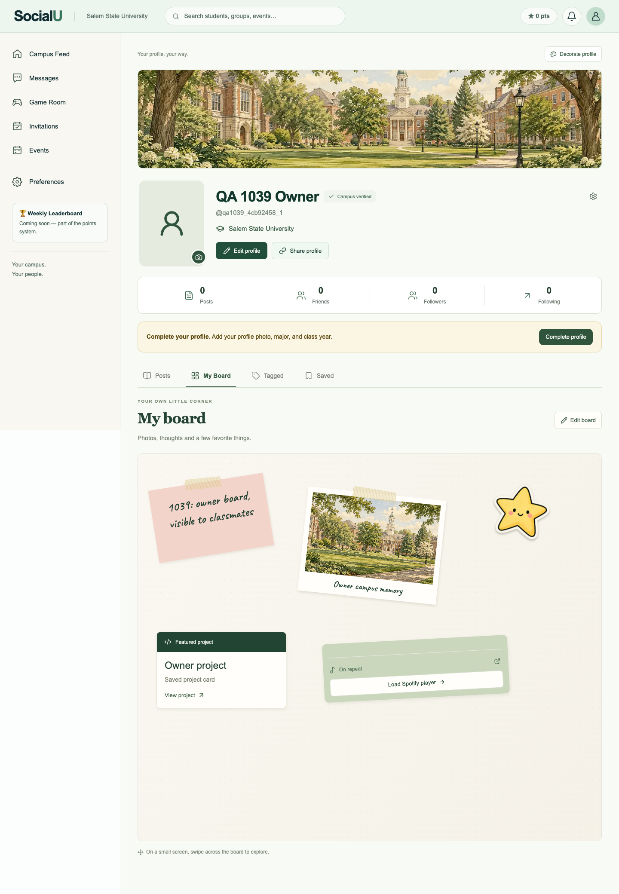
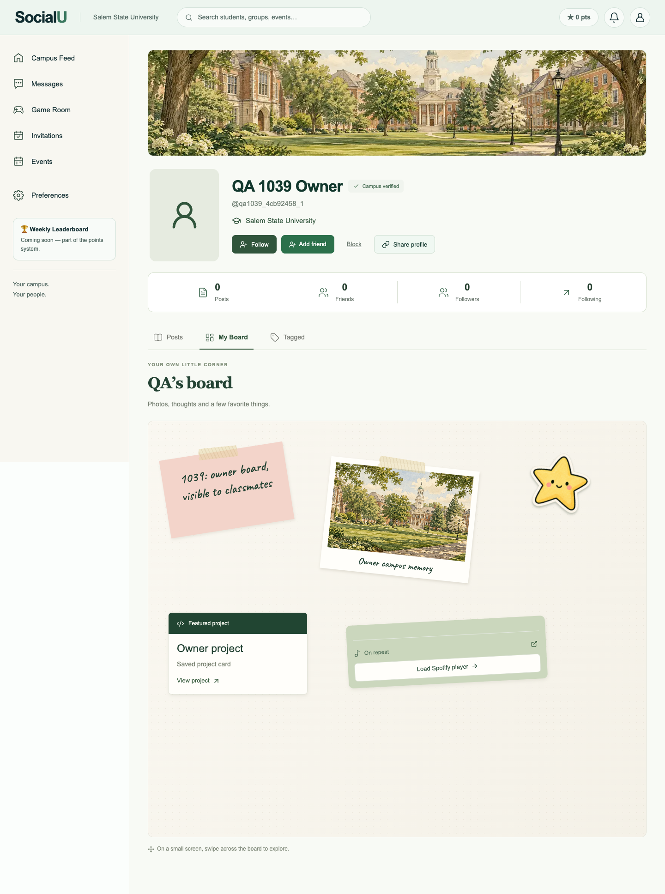

# Task #1040 — authenticated save and confirmation

Parent SRS-124.1 #1038 → UR-124. Owner Dieulinhh23. Branch `srs-124.1-task-1040-authenticated-save-acceptance` was created after #1039 merged/Done and before this task's test work. Original implementation PR #1043 and subsequent board fixes are already integrated; this follow-up verifies the API contract without inventing a production change.

45 focused tests pass: the existing 39 API tests plus six new integration tests invoking the actual PATCH handler and real PostgreSQL RPCs in disposable PGlite. Auth transport is a fixture. Deliberately injected unavailable/confirmation/order responses are labeled as test faults, not hosted failures.

| Acceptance | Observed result |
| --- | --- |
| Verified ownership | Forged owner fields do not replace another student's board; only the authenticated caller's own board changes |
| Authentication | Missing authentication returns 401 before RPC access |
| Validation | Out-of-bounds coordinates and duplicate item IDs return 400 without a database write |
| Preserve unrelated fields | A profile change committed immediately before the board RPC survives the atomic board write |
| JSONB ordering | Reversed confirmation-object key order still succeeds with semantically identical card data |
| Confirmation | A deliberately mismatched confirming read returns 503 instead of false success, with exactly one save call |
| Missing migration | Unavailable atomic RPC returns SPACE_PREVIEW; no stale full-look fallback write occurs |

[Executed six-check receipt](1040-evidence/api-postgres-checks.json) · [Source verification](1040-evidence/source-verification.json).

## Running-application evidence, reused with provenance

The approved hosted run completed during #1039 used actual Supabase Auth/PostgreSQL/private storage through the configured local production app. It exercised this same API source (SHA-256 match checked), including exact save/read and forged-owner protection. These screenshots and that trace are reused evidence from commit `a9d7160c88f2ab86f6102746972fe15445bac700`, not a second hosted test. No additional hosted accounts or writes were performed for #1040.

[Original hosted trace and successful cleanup](1039-evidence/hosted-contract-ownership-trace.json). Hosted frontend/API acceptance ran locally; Vercel's separate authentication configuration and historical migration-version mismatch are not resolved by this task.

## Class explanation

“The server derives the owner from the authenticated account, validates the board, merges only the board into the latest look, and reads it back before saying it saved. My tests verify that another student's details cannot redirect the save, newer profile edits survive, and a missing or mismatched confirmation produces an error instead of false success.”

Repeat with `npx vitest run __tests__/api/board-save-postgres.test.ts __tests__/api/profile-space.test.ts`. Optionally set `BOARD_API_EVIDENCE_DIR` for the integration receipt. The clean production build includes the new test's type validation. No migration or production behavior change is required. Parent/team review and #1041–#1042 remain separate; no planning history is backdated.
