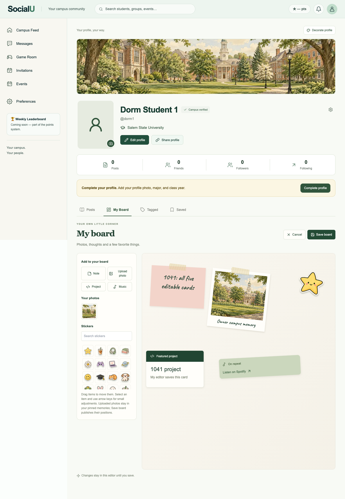
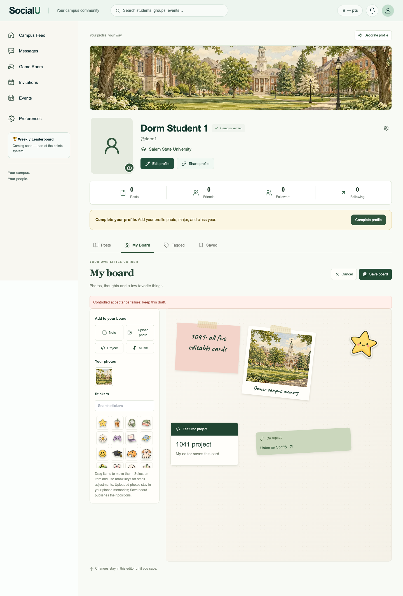
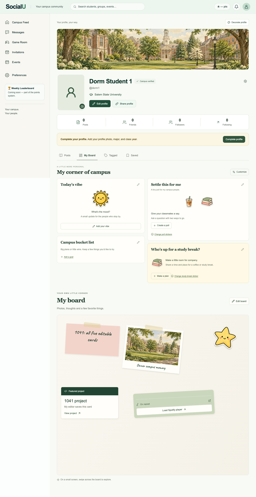
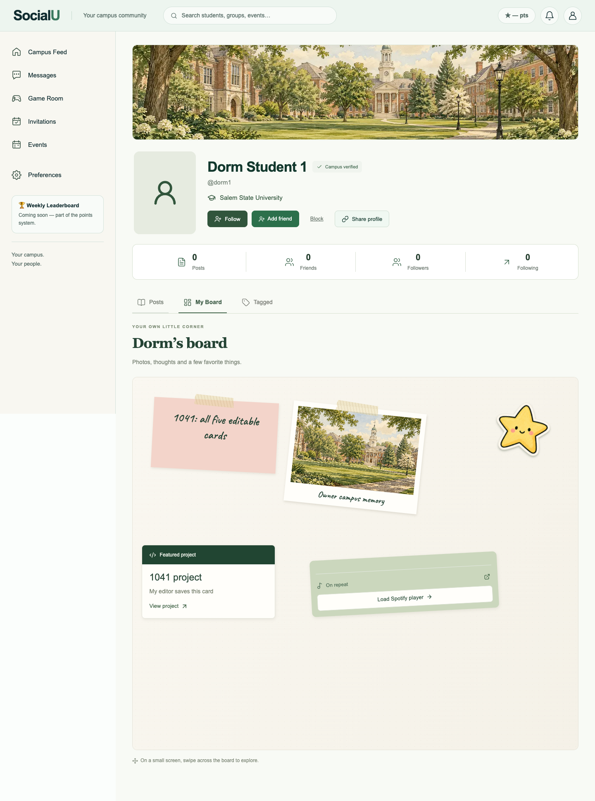

# Task #1041 — board editor acceptance

Parent SRS-124.1 #1038 → UR-124. Owner Dieulinhh23. Branch `srs-124.1-task-1041-board-editor-acceptance` was created after #1040 merged/Done, before this task's acceptance work. The editor implementation and its prior bug fixes are already integrated; this task adds concrete acceptance coverage without an unnecessary production change.

The running production app passed the new browser test against actual SQL in disposable PGlite. Supabase Auth/PostgREST/media signing use local fixtures. One save rejection is deliberately injected and visibly labeled, not a reported hosted outage.

| Interaction | Observed result |
| --- | --- |
| Content | Owner creates a note, owned pinned photo, star sticker, project and Spotify card |
| Arrangement | Keyboard and pointer movement, width changes and rotation update actual cards |
| Removal | A temporary sixth card is removed; the five intended cards remain |
| Failure | Rejected save shows an error and retains exact draft geometry; database is unchanged |
| Unsaved work | Cancel asks to discard; choosing Stay retains the draft |
| Save/reload | Retrying succeeds; PATCH, confirming GET and reloaded layout match |
| Tabs/privacy | Owner retains Posts, Tagged and Saved; visitor sees the saved board without Edit board or private Saved |

[Executed trace](1041-evidence/editor-acceptance-trace.json) · [Production source verification](1041-evidence/source-verification.json).

## Provenance and repeatability

The approved #1039 hosted Auth/PostgreSQL/private-storage test is reused for provider integration only; these editor interaction screenshots are new local acceptance evidence. The API, board component and board/look libraries match that hosted run by SHA-256. No additional hosted accounts, writes or migration occurred. [Original hosted trace and successful cleanup](1039-evidence/hosted-contract-ownership-trace.json). Vercel auth configuration and historical migration-history mismatch remain separate findings.

Run a clean production build, then `npx vitest run --config vitest.board-editor-evidence.config.ts`. Set `SOCIALU_PLAYWRIGHT_MODULE`, `BOARD_BROWSER_EXECUTABLE` and `BOARD_EVIDENCE_DIR` as needed. The build used a clean snapshot excluding unrelated local user edits. Spotify content is stored as a link; playback is opt-in and is not asserted as a third-party service test.

## Class explanation

“My Board lets the owner arrange five kinds of cards. I checked movement, resizing, rotation and removal through the real editor. When a save fails the draft stays available; after a successful retry, reloading restores the same layout. Other students can view it but cannot edit it or see my private Saved tab.”

Task #1042 and parent/team sign-off remain separate. No planning history or team approval is backdated.
