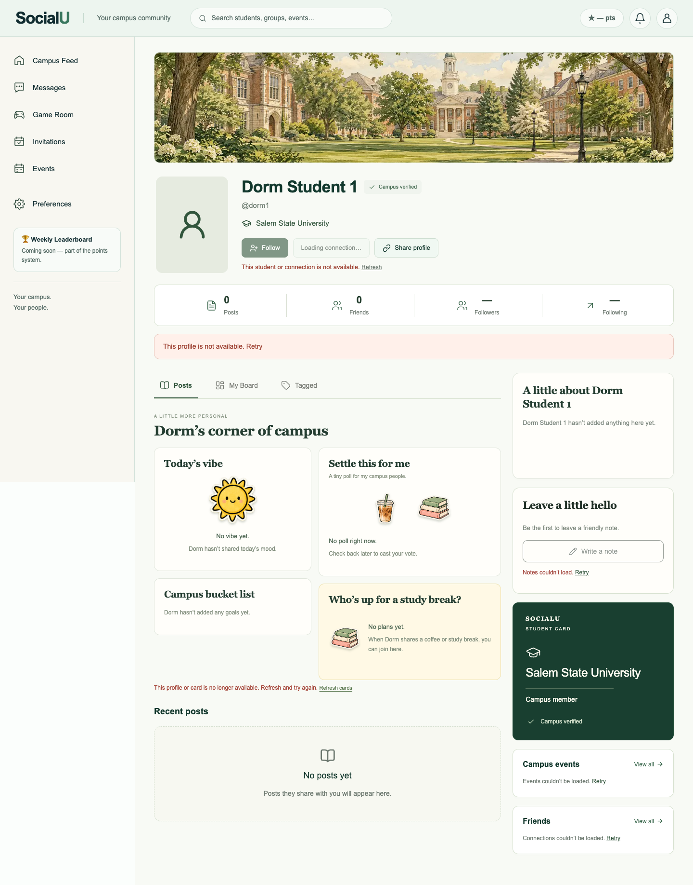
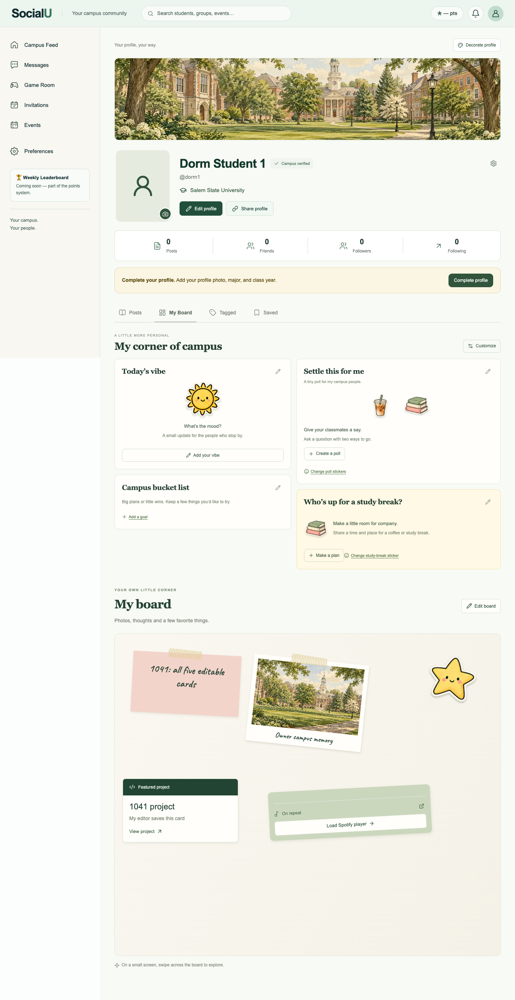
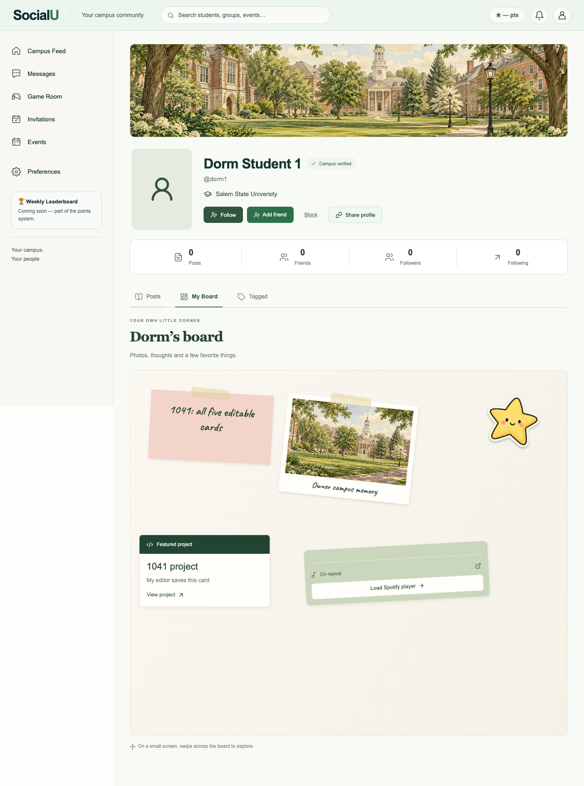
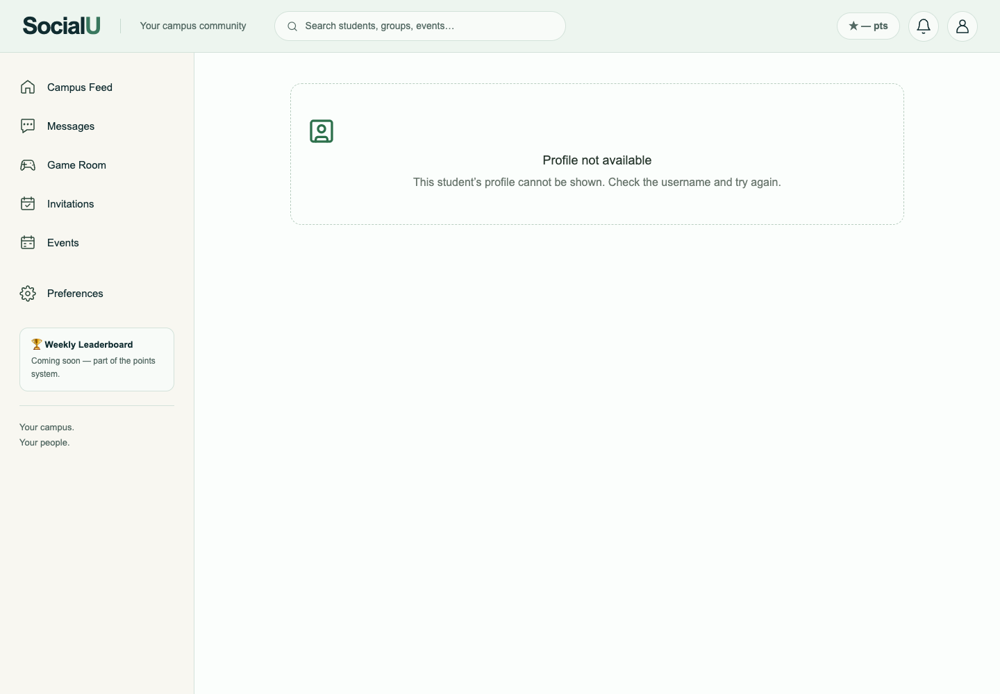

# Task #1042 — integrated My Board verification

Parent SRS-124.1 #1038 → UR-124. Owner Dieulinhh23. Branch `srs-124.1-task-1042-integrated-board-verification` was created after #1041 merged/Done and before this verification work. The existing vertical slice is integrated; this follow-up adds a reusable local acceptance runner, fresh evidence and an accurate SRS status.

## Verification scope

The clean snapshot starts at main commit `540caa4944632e7b9ef7a6bcf2f16b53fa6a9ad2`, with this task's runner, server fetch-freshness fix and strengthened blocked-viewer test overlaid. Unrelated local profile-settings edits are excluded. The newly found #1291 changes production behavior: provider reads explicitly bypass the server fetch cache so current permissions apply.

`node scripts/tests/verify-board-slice.cjs` runs the focused tests, production build and five local browser suites sequentially. Set `BOARD_VERIFICATION_DIR`, `BOARD_VERIFICATION_COMMIT`, `SOCIALU_PLAYWRIGHT_MODULE` and `BOARD_BROWSER_EXECUTABLE` as needed. It records per-step results and hashes and stops on failure. It never invokes the opt-in hosted script.

| Layer/check | Result |
| --- | --- |
| All API tests, board validation, real SQL, history guard and provider freshness | 1,039/1,039 tests in 70 files |
| Production compilation and TypeScript | Passed |
| Atomic save, bounded rotation, Back/Forward draft protection | 3/3 browser checks |
| Photo ownership | 1/1 browser check |
| Exact uploaded-photo identity | 1/1 browser check |
| Owner/viewer/block contract | 1/1 browser check |
| Five-card editor, save failure/retry/reload, visitor/privacy | 1/1 browser check |

Captured logs have terminal color codes/trailing whitespace removed; results are unchanged.

[Machine-readable execution receipt](1042-evidence/verification.json) · [Pre-merge GitHub task/branch audit](1042-evidence/github-task-audit.json).

The first combined run exposed a false-positive possibility in the original blocked-UI assertion: the one-second check could pass while the page showed its loading skeleton. Waiting for the settled page exposed actual defect [#1291](https://github.com/SonjaSeferasi/ssu-starter-app-v2/issues/1291): direct SQL rejected the blocked viewer with P0002 and the board API returned 404, yet the profile API reused a previous 200 header without another provider RPC. The local Next fetch cache contained that RPC response.

The fix sets `cache: 'no-store'` in the shared server Supabase fetch transport. This makes permission/session-sensitive provider requests read current state. It preserves fresh clients, SDK request options and server-only credentials. The strengthened browser check requires both the profile API's 404 and the settled “Profile not available” page, not transient absence of a tab. A new real-SDK regression simulates the shared fetch cache: the old transport returns stale permission after blocking and fails; the fixed transport reads the changed result. Broader API tests cover the shared-client impact. No migration is required.

[Before-fix diagnostic receipt](1042-evidence/1291-before-fix.json) · [Expected failing transport regression](1042-evidence/1291-baseline.log).

## End-to-end evidence

All local browser tests exercise the actual production UI/API and actual SQL in disposable PGlite; provider Auth/PostgREST/media signing are fixtures. Injected save failures, race pauses and unavailable/confirmation responses are explicitly test faults. These are genuine running-app captures, not mockup images.

[Editor execution trace](1042-evidence/editor-acceptance-trace.json) · [Ownership/block execution trace](1042-evidence/contract-ownership-trace.json).

Actual Supabase Auth/PostgreSQL/private-storage acceptance was completed once for #1039 after explicit user approval, using two new private QA accounts. Exact content/layout, authorized viewer, forged-owner/foreign-write protection and blocking passed. All cleanup stages passed: boards cleared, the test photo/storage object removed, accounts deactivated and app sessions revoked. Deactivated account/audit records may remain. [Original hosted trace](1039-evidence/hosted-contract-ownership-trace.json). Later tasks reuse that evidence explicitly; the core board API, component and board/look library hashes match. The shared server provider transport now explicitly disables caching (#1291), which is verified by the new local real-SDK/browser regressions; the approved hosted run predates that transport change. No additional hosted execution/accounts/writes occurred for #1042.

## Traceable integration

| Task | Actual SRS branch | PR |
| --- | --- | --- |
| #1039 data/ownership | [srs-124.1-task-1039-data-ownership-acceptance](https://github.com/SonjaSeferasi/ssu-starter-app-v2/tree/srs-124.1-task-1039-data-ownership-acceptance) | [#1280](https://github.com/SonjaSeferasi/ssu-starter-app-v2/pull/1280) |
| #1040 authenticated API | [srs-124.1-task-1040-authenticated-save-acceptance](https://github.com/SonjaSeferasi/ssu-starter-app-v2/tree/srs-124.1-task-1040-authenticated-save-acceptance) | [#1284](https://github.com/SonjaSeferasi/ssu-starter-app-v2/pull/1284) |
| #1041 editor | [srs-124.1-task-1041-board-editor-acceptance](https://github.com/SonjaSeferasi/ssu-starter-app-v2/tree/srs-124.1-task-1041-board-editor-acceptance) | [#1286](https://github.com/SonjaSeferasi/ssu-starter-app-v2/pull/1286) |
| #1042 integrated acceptance | [srs-124.1-task-1042-integrated-board-verification](https://github.com/SonjaSeferasi/ssu-starter-app-v2/tree/srs-124.1-task-1042-integrated-board-verification) | Linked from task #1042 and parent #1038 |

Each follow-up branch contains substantive work created on it, and each PR closes its own task. Tasks are assigned to Dieulinhh23 and formal children of #1038. #1039–#1041 were verified merged/Done before the next task began. The original prototype was written before its SRS branch registration; that historical process finding remains visible.

Code review for this verification checked the API's verified-user identity, validation and confirming read, the row-locked JSONB board merge, photo-reference trigger and editor dirty/save/viewer controls against the acceptance tests. This agent review and successful integration do not substitute for independent team/stakeholder sign-off. No formal peer approval is claimed.

## Limits and class demo

The previously observed Vercel authentication-configuration 503 and remote migration-history mismatch remain separate findings. A green build/preview is not proof that deployed authentication is configured. Use the configured integrated local app for the demonstrated hosted-data behavior until deployment readiness is resolved. Spotify playback/OAuth is outside this acceptance.

Parent #1038 remains open for team/stakeholder review of the addendum. Technical task completion does not complete the team's QA metrics slides, Canvas submissions or demo attendance.

Say in class: “This feature is a complete database-to-screen slice. The owner arranges five kinds of cards, saves, and gets the same content and layout after reload. The server derives ownership from the signed-in account and confirms storage before reporting success. Classmates have read-only access, blocked viewers lose access, and a failed save keeps the draft. I verified the API/database regression suite, seven browser checks and the production build, with a separately approved real Supabase acceptance test.”

Demo: show #1038 and its linked tasks/PRs, arrange a note/photo/sticker/project/music card, change size/rotation, save and reload, then use a separate authorized viewer session to show no Edit board/private Saved. The QA accounts from the hosted test are deactivated and must not be used for a future demo without a newly authorized setup.

The explicit fetch option follows [Next 14's per-request no-store guidance](https://nextjs.org/docs/14/app/building-your-application/data-fetching/fetching-caching-and-revalidating).
