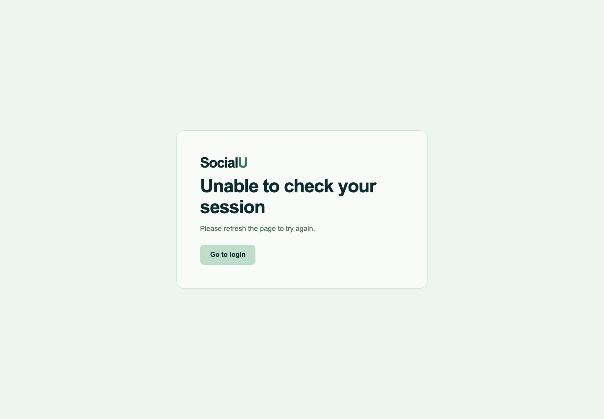

# SRS-124.1 — deployed authentication readiness (#1299)

Owner: Linh Nguyen / Dieulinhh23. Traces to SRS-124.1 #1038 → UR-124. Branch `srs-124.1-vercel-authentication-readiness` was created from integrated main before this work. Status: **In progress; deployed repair and acceptance pending**.

## Confirmed failure

On November 17, 2026, `https://ssu-starter-app-v2.vercel.app/api/profiles/space` and `/api/account/login-activity` returned HTTP 503 “Authentication is unavailable. Check the server Supabase configuration.” with an explicitly invalid probe token. Current server code emits this when the effective Supabase URL/key is absent, before token verification. The actual Production environment, active deployment/source revision and precise missing variable still require Vercel project access; a successful local build does not establish those facts.

A fresh production browser context, with all non-GET requests blocked, returned 503 from `/api/auth/session` and displayed the actual session error below. No login attempt, account creation, board write or database change was made.

[Read-only API receipt](vercel-auth-evidence/01-production-before.json) · [Production UI request trace](vercel-auth-evidence/02-production-before-ui.json).

## Prepared fix and local validation

Vercel's repository build command now invokes `scripts/vercel-build.cjs` before the normal Next build. It stops deployment if server URL/service credentials or browser anon configuration is missing, server/browser URLs identify different projects, or a service credential is explicitly reused as a public key. Diagnostics print variable names, never values. `.env.example` restores the missing setup template using placeholders and explains server-only credentials. Normal local `npm run build` remains available for isolated fixtures.

This prevents publishing a missing-configuration build. **It does not install credentials into Vercel or repair the current live deployment by itself.** Presence checks do not validate a key, establish project access or test login. The read-only `scripts/check-deployed-auth.cjs` makes the 503-versus-401 check reproducible and explicitly requires separate authenticated acceptance.

90 tests across four files passed, including seven new configuration/CLI tests, existing real-SDK freshness behavior, login/registration API tests and board API tests. The exact Vercel wrapper also completed the clean production build/TypeScript checks using non-secret fixture environment values. Unrelated local profile edits were excluded.

[Executed test log](vercel-auth-evidence/03-local-tests.log) · [Clean build log](vercel-auth-evidence/04-clean-build.log) · [Source and limitation receipt](vercel-auth-evidence/05-verification.json). Logs have terminal formatting/trailing whitespace removed; results are unchanged.

## Live repair steps when access is available

1. Open the repository-linked `sonja2/ssu-starter-app-v2` Vercel project. Verify its Git repository is `SonjaSeferasi/ssu-starter-app-v2`, Production branch is `main`, and confirm the actual production domain before changing anything. The current account receives Not Found; no different private account is assumed or accessed.
2. Verify Supabase project `sfrpokisjlwgknxlzllu`. In the intended Vercel Production and Preview scopes, configure the existing effective variables. Reuse matching values from the authorized local configuration/provider dashboard without placing keys in GitHub, screenshots, logs or chat.

| Variable | Purpose |
| --- | --- |
| `SUPABASE_URL` | Server project origin; expected `https://sfrpokisjlwgknxlzllu.supabase.co` |
| `NEXT_PUBLIC_SUPABASE_URL` | Same project origin for browser integrations; server URL is also an existing fallback |
| `SUPABASE_ANON_KEY` | Public anon/publishable key, also exposed through the existing Next config alias |
| `SUPABASE_SERVICE_ROLE_KEY` | Private server bridge for account, session and board RPCs; never a `NEXT_PUBLIC_` value |
| `NEXT_PUBLIC_SUPABASE_ANON_KEY` | Optional public alias; if present it must match the intended public key |

3. Rebuild/redeploy after changing scoped environment variables. Public values are embedded at build time. Check the new deployment belongs to the intended branch/commit. Validate Preview first, then integrate the reviewed PR and verify Production; do not claim that a code-only merge installed the environment configuration.
4. Run `node scripts/check-deployed-auth.cjs https://<verified-deployment-domain>`. Both invalid-token requests should return 401, not configuration 503. This alone does not establish valid credentials or a working database bridge.
5. Sign in through the deployed app using an authorized demo account. In the running app, save an identifiable board arrangement, change width/rotation, reload and observe the same values. Capture actual after-fix UI and network receipts without tokens. Verify owner/viewer/block permissions with authorized test sessions if doing the full acceptance again. Any new hosted QA-account/admin mutation test needs its own approved scope; the earlier #1039 test is historical and its QA accounts are deactivated.
6. Attach the actual after-fix screenshot/deployment/PR links to #1299 and #1038. Mark #1299 Done/closed completed only after live acceptance and PR integration. Keep the separate team/SRS-addendum sign-off open.

The existing remote Supabase migration-history mismatch is a separate finding; no schema reset, deletion or migration-history rewrite is part of this configuration repair.

Official references: [Vercel repository build command](https://vercel.com/docs/project-configuration/vercel-json), [scoped environment variables and redeployment](https://vercel.com/docs/environment-variables/managing-environment-variables), [Next 14 environment variables](https://nextjs.org/docs/14/app/building-your-application/configuring/environment-variables).

## Class explanation

“The board worked with the configured local app, but the deployed server could not initialize authentication. Local environment settings do not automatically configure the deployed project. I added a deployment check that rejects missing Supabase settings before publishing. The live fix still requires verified Vercel environment configuration, a new deployment and an actual signed-in save/reload test; I have not claimed those pending steps passed.”
